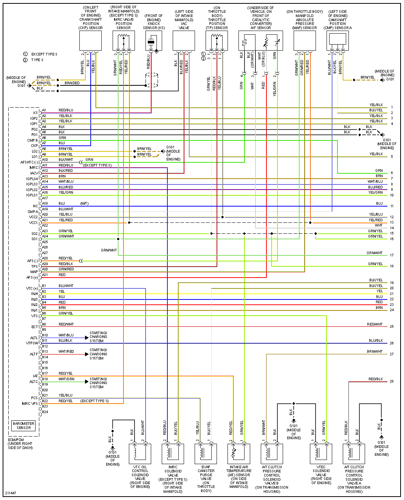
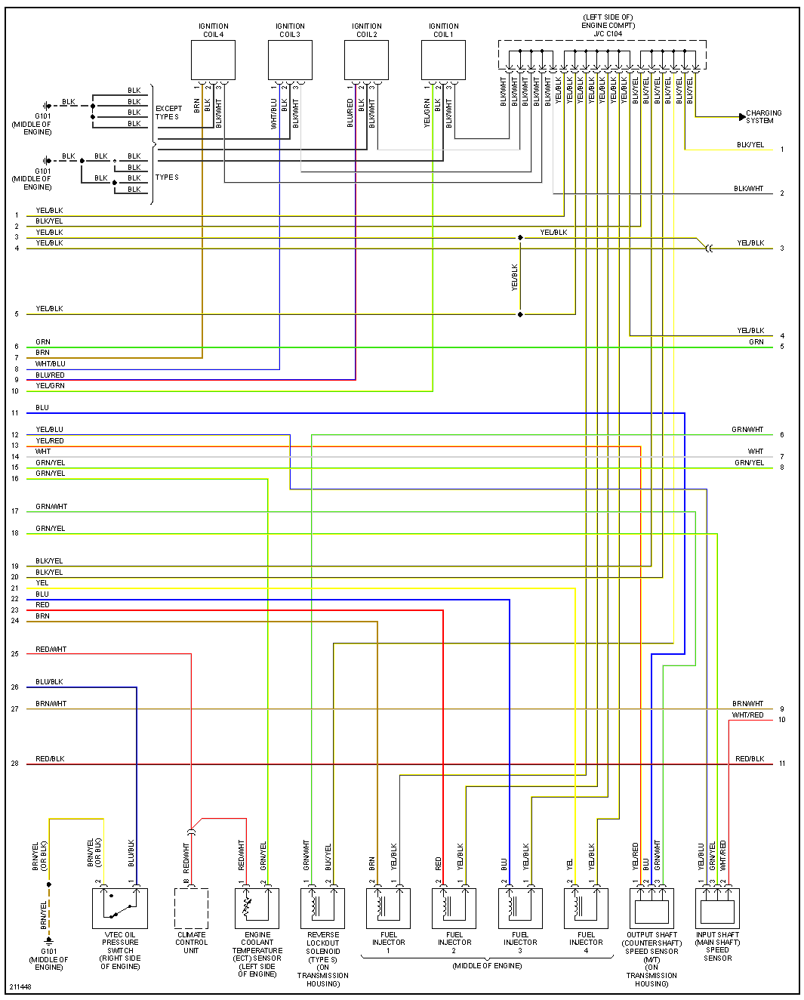
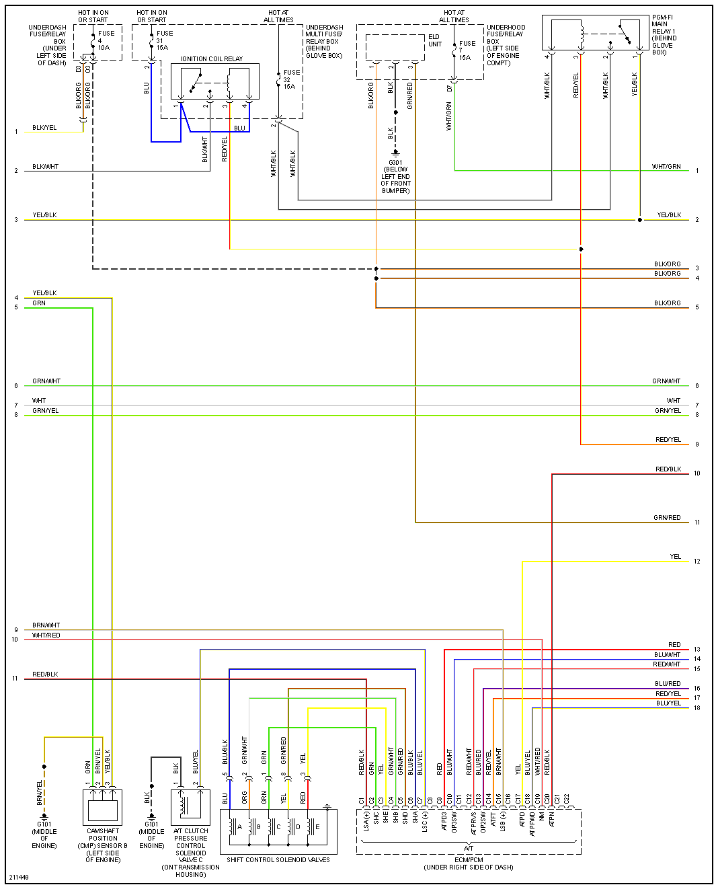
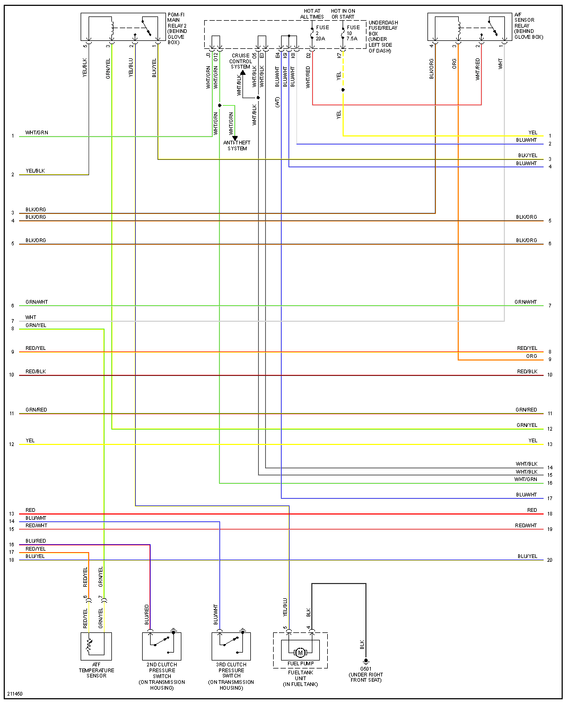
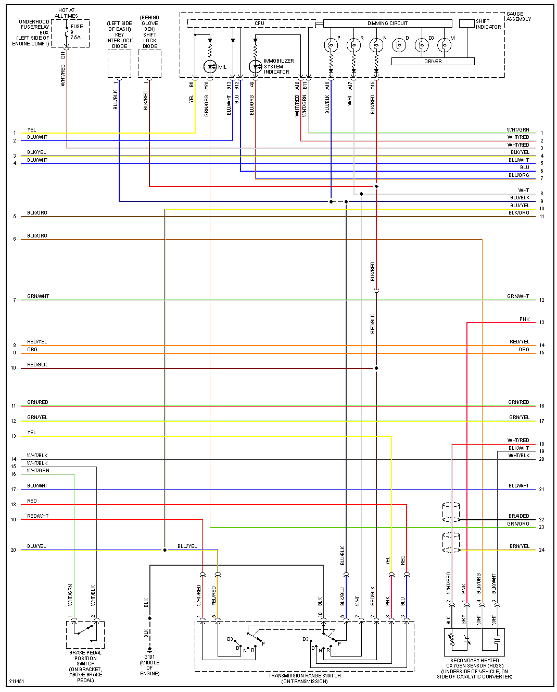
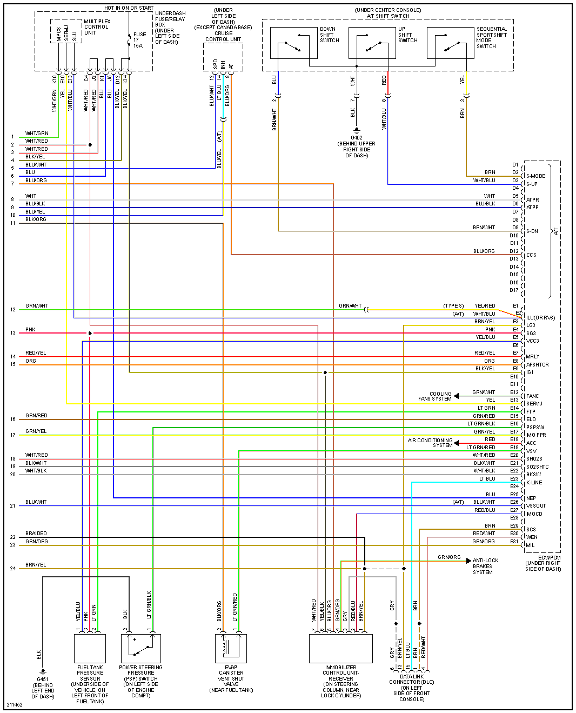

# Acura RSX

[Transcribed 2002–04 and 2005–06 ECM/PCM terminal lists](OEM-Docs/Honda/2002-2006-Acura-RSX-ECM-pinouts.md), including all 125 positions in each group. See [Honda 125-pin variations](Honda-125-variations.md) for the changes between them and other Honda applications.

## 2003

[2003-acura-rsx-type-R.pdf](https://github.com/rusefi/rusefi_documentation/raw/master/OEM-Docs/Honda/2003-acura-rsx-type-R.pdf)

The PDF's printed vehicle title is **2003 Acura RSX Type S**, despite the filename saying Type R; its diagrams include alternative base/Type S branches.

## 2005

