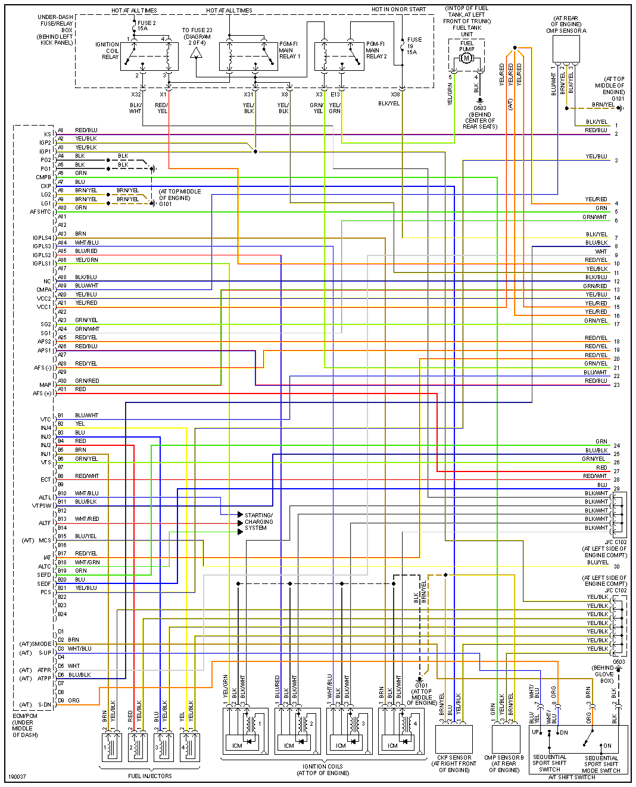
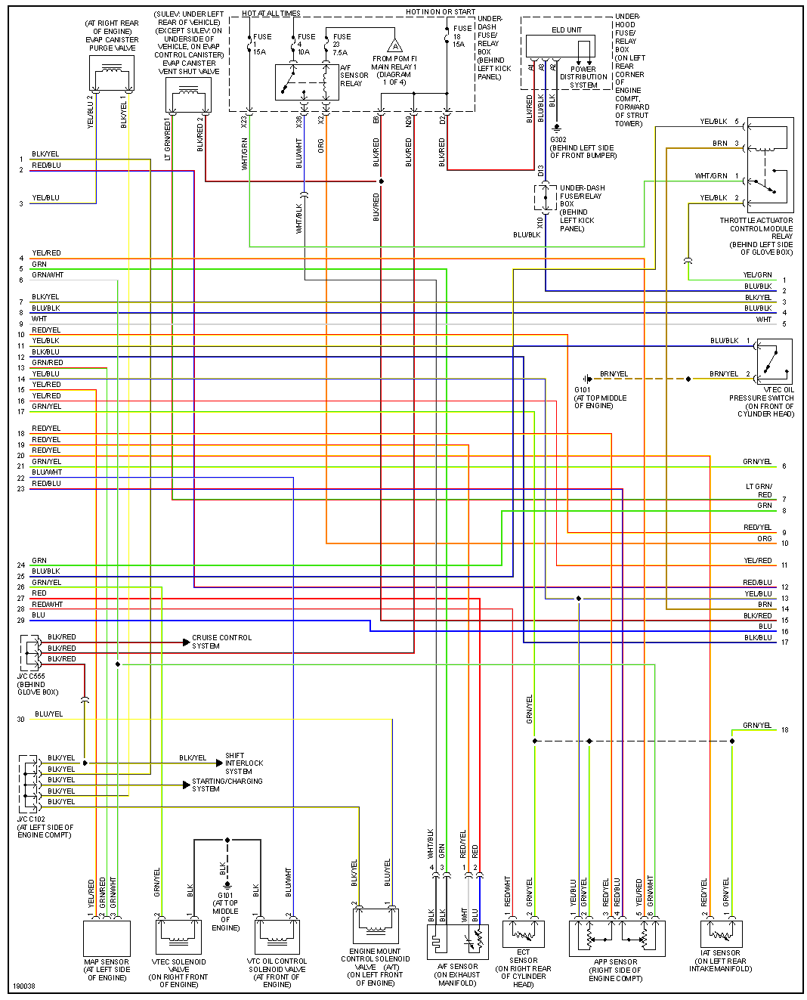
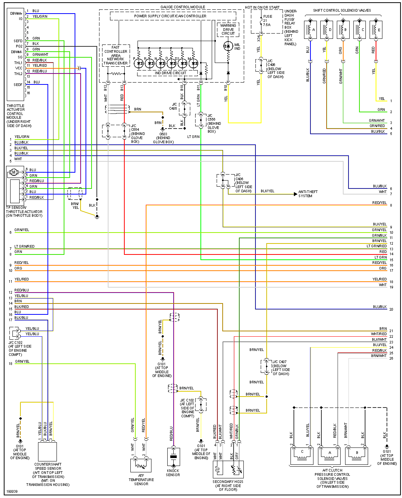
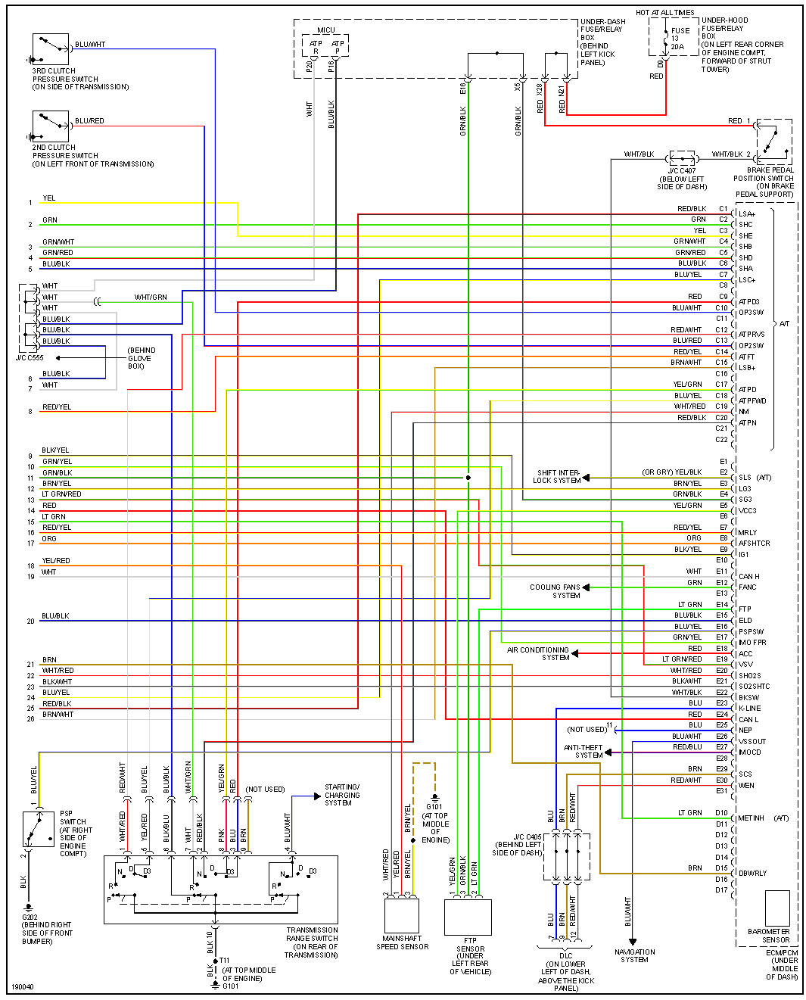

# Acura TSX

## 2005

[Transcribed ECM/PCM pinout](OEM-Docs/Honda/2005-Acura-TSX-2.4L-ECM-pinout.md) and [Honda 125-pin variation comparison](Honda-125-variations.md).

## 2007

[Transcribed ECM/PCM pinout and source sheets](OEM-Docs/Honda/2007-Acura-TSX-2.4L-ECM-pinout.md). This source adds ECT2 at E1, omits the 2005 E23 K-line wire and changes several wire colours.
