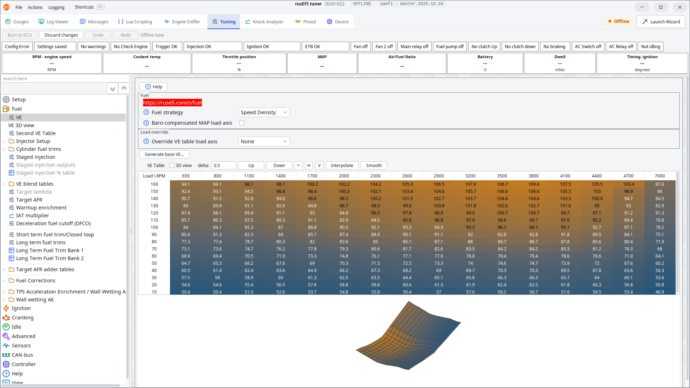
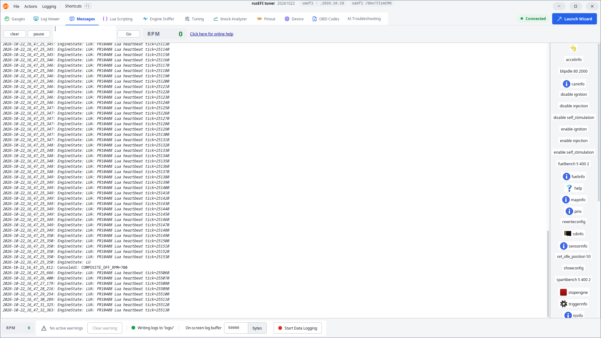
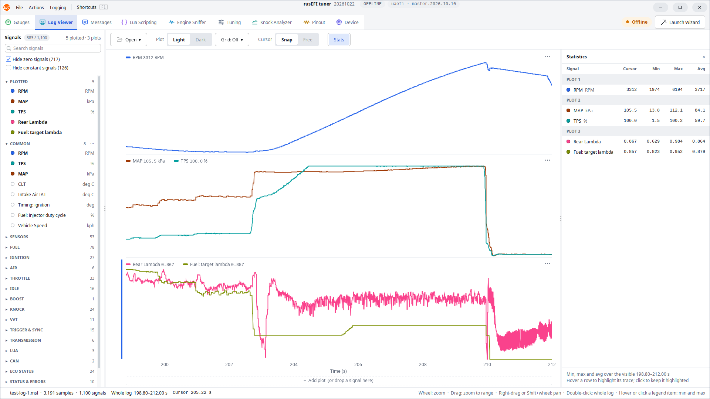
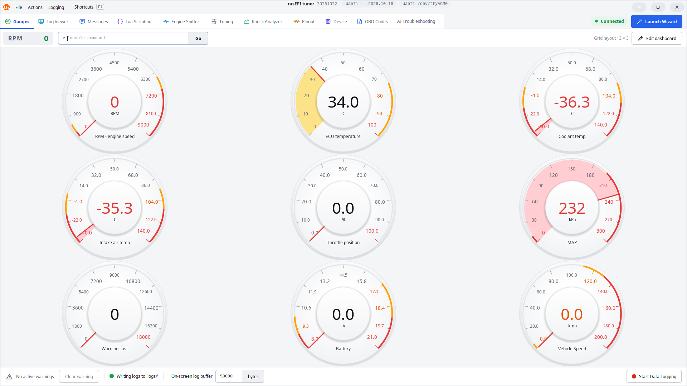
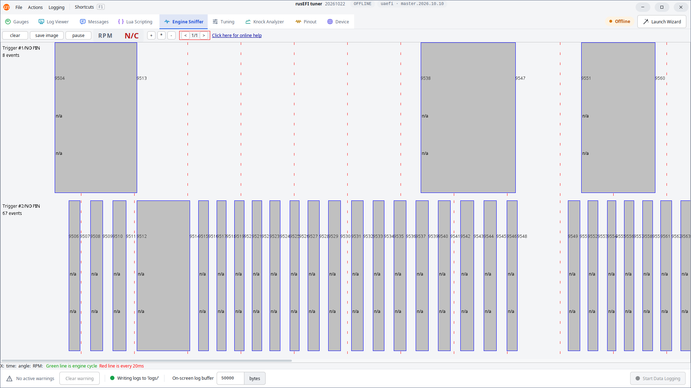

# rusEFI tuner

rusEFI tuner is the desktop application for connecting to a rusEFI ECU, editing
and managing its tune, updating firmware, and using diagnostic tools. Its
**Log Viewer** tab is a built-in, beginner-friendly way to view and explore
recorded ECU logs without installing a separate log-analysis application. It
covers common viewing and basic analysis workflows; users who need more
specialized or advanced analysis can still use MegaLogViewer or another tool.

Offline example with an illustrative generated VE table, not a recommended
calibration. No live ECU values are shown.

* [Download rusEFI tuner for Windows](https://rusefi.com/installer/rusEFI_Universal_Updater.exe)

## Start tuning

1. Download and run the Windows installer above, then start **rusEFI tuner**
   from its desktop shortcut or the Windows Start menu.
2. Connect the ECU to the computer over USB and allow the application to
   discover and connect to it. Install the offered drivers if needed.
3. Open **Tuning** to view and edit calibration settings. When connected,
   edits take effect without being permanently saved. Use **Burn to ECU** to
   save them on the ECU; stop the engine and confirm the save before
   switching power off. Use **File > Save Tune** to save a tune file on your
   computer. Saving a file does not save changes on the ECU. Unsaved ECU changes
   are lost after a restart. Offline edits only change the tune on your computer.
4. To record ECU data, choose **Logging > Start** (default folder) or **Logging
   > Start As…** (choose a file), then choose **Stop** when finished. To inspect
   a recording, open **Log Viewer** and choose **Open log…**. Recording needs a
   live ECU connection; viewing a saved log does not.
   See [Binary logging](#binary-logging) and [Log Viewer](#log-viewer).

### App updates and ECU firmware

The application can update its own software automatically. This does **not**
update the firmware running on your ECU; that is a separate action.

Before updating ECU firmware, read [How to Update Firmware](HOWTO-Update-Firmware).
The installed universal application uses snapshot firmware by default, even if
your ECU currently runs Release/LTS firmware. To stay on Release/LTS, use the
application from the matching downloaded bundle instead.

For a normal update, save a tune backup, connect the ECU, and choose **Update ECU
firmware**. Follow the prompts; when offered, **Try to keep my current tune**
attempts to preserve it but is not a guarantee. **Update application** updates
rusEFI tuner on your computer, not the ECU. Review the result and
check the firmware version and settings before using the ECU.

See [Release vs. Snapshot](Release-Snapshot-Latest-firmware) for help choosing a
version or changing automatic app updates.

### Main tabs

| Tab | Use it to |
|---|---|
| [Gauges](#gauges) | View live gauges and graphs from a connected ECU. |
| [Tuning](#editing-settings) | Find and edit calibration settings. |
| [Messages](#messages) | Read ECU text and send rusEFI commands. |
| [Log Viewer](#log-viewer) | Open and explore a saved `.mlg` or `.msl` recording. |
| [Engine Sniffer](#engine-sniffer-chart) | Inspect trigger/composite event charts when available. |
| [AI Troubleshooting](#ai-troubleshooting) | Ask for help interpreting ECU evidence; information is sent to OpenAI. |

Tabs and tools vary by connection mode, ECU firmware, and enabled features.

## Messages

The **Messages** tab shows text from the ECU and lets you send rusEFI commands.
Commands can operate connected hardware. Send only commands you understand or
that you have been instructed to use.

Connected uaEFI on the bench; the engine is stopped.

## Binary logging

To record a log:

1. Connect to the ECU and choose **Logging > Start** to begin in the default
   folder, or **Logging > Start As…** to choose a filename and location.
2. Choose **Stop** when finished. **Ctrl+S** also starts or stops recording; it
   does not save a tune.
3. Open **Log Viewer** and choose **Open log…** to view the recording. You can
   also open the most recent log with **Logging > View Last Log**.

**Save tune** is enabled by default. It saves a copy of the tune from the start
of recording beside the log and inside the `.mlg` file. It does not capture later
tune changes in that same copy. Recording needs a live ECU connection; viewing a
saved log does not.

## Log Viewer

Open a saved `.mlg` or `.msl` in **Log Viewer** and choose **Open log…**. You can
also press **Ctrl+O** while the tab is selected or choose a recent log. No live
ECU connection is needed to view a saved log.

If you start without an ECU and see the startup screen, choose **Manage Tunes >
Load Tune File** and open a saved `.msq` tune to enter the application. The tune's
matching ECU definition file (`.ini`) must be available. Then open **Log Viewer**
and load the log. You can use the tune copy saved with a recording when **Save
tune** was enabled.

Example using a sample recording; the plotted channels are not live ECU readings.

The **Signals** panel lists channels in the log. Search or expand a group, then
click a signal to add it to a plot; click it again to remove it. Plots start
empty so you choose what to view. To add a useful group of signals, open the
**⋯** menu beside **Common** and choose **Plot all**.

### More options

Scroll the mouse wheel to zoom around the pointer. Left-drag across a time range
to zoom in; right-drag or **Shift+wheel** to move through the log. Double-click
the chart background to show the full recording again. **Stats** shows values
over the visible time range. Each trace has its own scale, so line heights do not
directly compare values between signals.

For more detailed log analysis, MegaLogViewer remains an optional tool.

## Editing settings

Open **Tuning** and choose a section from the menu to find settings. Select a
setting's **Help** button when available for its instructions. Use the shared
tuning controls to undo, discard, save a tune file, or burn changes to the ECU.
In **Pinout**, double-click an assigned pin to open its settings page.

## Keyboard shortcuts

Open **Shortcuts** in the menu bar or press **F1** to see the keyboard reference.
For tuning tables, the common controls are:

| Action | Shortcut |
|---|---|
| Move between cells | Arrow keys |
| Select more cells | **Shift** + arrow keys |
| Edit a cell | Type a number, press **F2**, or double-click |
| Accept or cancel an edit | **Enter** or **Esc** |

The reference also lists shortcuts for other parts of the application.

## Connecting over CAN

rusEFI tuner automatically checks for USB connections and supported CAN
connections.

* **PCAN on Windows:** install the PEAK driver and connect the adapter to the
  ECU's CAN wiring.
* **SocketCAN on Linux:** set up the CAN interface with the correct bus speed
  before starting rusEFI tuner.

At startup, the application connects automatically when it finds one available
ECU. If several are found, select the one you want on the **Connect** screen.
Detecting an adapter alone is not enough—the ECU must respond through it.

SLCAN serial-to-CAN adapters need separate setup. The **SLCAN Sniffer** tab is
for viewing CAN traffic, not for establishing a tuning connection to the ECU.

## Gauges

Choose **Edit dashboard** to change the layout:

* **Grid layout** fills rows and columns; **Grid size** chooses their count.
* **Free layout** lets you position and size gauges individually. Use **Add
  gauge…** to add one, then **Arrange gauges** to move or resize them. Choose
  **Done** or press **Esc** to finish arranging.

Right-click a gauge to change its selection or switch to live graphs. Choose
**Save layout…** to save the dashboard, or **Load layout…** to use a saved layout.

Connected uaEFI on the bench, with the engine stopped. These sensor readings
are not a calibrated running-engine example.

## Configuration errors

If **Config Error** appears, read the displayed explanation and correct the
setting it identifies. **Close** hides the message; it does not fix the error.
If you are unsure what to change, save your tune and ask for help.

## AI Troubleshooting

The **AI Troubleshooting** tab helps explain ECU readings, settings, and error
messages. It is available when connected to an ECU and uses your ChatGPT account.

### Get started

1. Connect to your ECU and open **AI Troubleshooting**.
2. If prompted, click **Start Download** and wait for the reference files to
   finish downloading.
3. Choose **Continue with ChatGPT** and sign in using your browser, or choose a
   saved account.
4. Select a model and describe the problem. Include what you expected to happen
   and what you observed.

For example, ask “What does this error mean?” or “Which readings should I check
when the engine will not start?” The assistant can check ECU readings and
messages, look at selected settings, and consult the rusEFI documentation.

**It does not change your tune, update firmware, or control engine outputs.**
Its answers can be wrong or incomplete. Check its suggestions before making
changes, and use proper logs when asking others for help.

**Privacy:** your questions and the ECU information used to answer them are
sent to OpenAI. This can include readings, settings, messages, and Lua script
excerpts. Do not include passwords or other sensitive information.

Use **Stop** to cancel a reply or **New conversation** to start over. To save a
summary for later, ask it to **export a diagnostic case**. Review the saved
information before sharing it.

## Engine Sniffer chart

Offline sample trace, not a live capture from the connected ECU. This example
has no pin mapping or cycle-angle information, so those labels show **NO PIN**
and **n/a**.

The Engine Sniffer chart displays engine-cycle events, not a recorded `.mlg`/
`.msl` data log. When cycle information is available, the green line marks the
border of an engine cycle. The current cycle angle appears in the bottom-left
corner (0–720 degrees for a
four-stroke engine).

The red line is the absolute time scale, with one line every 20 ms.

## SLCAN Sniffer

When supported by the connected ECU, rusEFI tuner shows the **SLCAN Sniffer**
tab for viewing CAN traffic. For details on connecting an adapter or capturing
traffic with MCP, see [MCP capture through the built-in
sniffer](Dev-Console-Implementation.md#mcp-capture-through-the-built-in-sniffer).

## FAQ

### Why won't rusEFI tuner connect to my ECU?

Check that the ECU has power and the USB cable supports data, not just charging.
Close TunerStudio or any other application using the ECU connection. Install
the offered drivers if needed, then check the **Connect** screen. If several
ECUs are listed, select the one you want.

### What is the difference between Save Tune and Burn to ECU?

**File > Save Tune** saves a tune file on your computer. **Burn to ECU** saves
changes on the ECU so they survive a restart. Saving a file does not save those
changes on the ECU. Stop the engine and confirm the ECU save before switching
power off.

### Does updating the application also update my ECU?

No. Updating the application and updating ECU firmware are separate actions.
Before updating the ECU, read [How to Update Firmware](HOWTO-Update-Firmware)
and check whether you want Release/LTS or snapshot firmware.

### Do I need TunerStudio or MegaLogViewer to get started?

No. You can edit settings, record logs, and view them in rusEFI tuner.
TunerStudio and MegaLogViewer remain options for more advanced workflows.

### Can I view a log without connecting the ECU?

Yes. Once the main window is open, choose **Log Viewer > Open log…** and select
a `.mlg` or `.msl` file. If you are on the startup screen without an ECU, first
load a saved tune as described in [Log Viewer](#log-viewer).

### Why is the Log Viewer chart empty after I open a log?

Choose a channel in **Signals** to plot it. To add a group, open the **⋯** menu
beside **Common** and choose **Plot all**. Double-click the chart background to
show the full recording if you have zoomed in too far.

### Does Ctrl+S save my tune?

No. **Ctrl+S** starts or stops log recording. Use **File > Save Tune** to save a
tune file, or **Burn to ECU** to save changes on the ECU.

### What should I share when asking for help?

Share your tune file, a recorded log, the ECU firmware version, and a short
description of the problem. Explain what you expected and when the problem
occurred in the log. A screenshot alone is not a replacement for a log file.
See the [Logging Guide](Logging-Guide) for help recording one. Review files for
sensitive information before sharing them.
