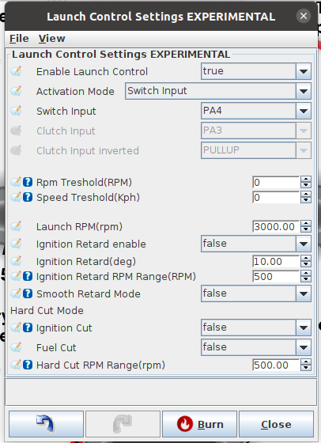

# How to Set up Launch Control

You can find this feature under Controller > Launch Control

Configuration Fields:

**Enable LaunchControl:** true to enable/false for disable function

**Activation Mode:** - Switch Input

- Switch Input: Active while switch is pressed
- Clutch Input: Any time clutch is pressed, function would limit RPM
- Always Active (Disabled By Speed): once VSS registers a speed grather then preset value, function would disable.

**Rpm Treshold(RPM):** todo

**Speed Treshold(Kph):** If Activation mode is Always Active, while the vehicle speed is under this value, launch will limit max rpm as configured.

**Launch RPM (rpm):** RPM value to hold at launch, in this example 3000 RPM is used.

**Ignition Retard enabled:** In case this field is set to true, ignition would be retarded to the preset value in field Ignition Retard(deg).

**Ignition retard(deg):**: Desired ignition value while we do launch. This value is used while engine in inside launch window. In the picture above 500 preset so that means from 2500 - 3000 the engine would run with 10 degree of ignition.

**Smooth Retard Mode:** While true, ignition would me smoothly retarded in the window 2500-3000. Final ignition advance is 10 degree, but it is only reached at 3000 rpm.

**Ignitio Cut:** In case RPM would shoot over the target value, ignition cut is used to stop engine acceleration. If only this is used, and Fuel Cut is on the magical flames could be noticed. Note: this could do bad things to the engine.

**Fuel Cut:** In case RPM would shoot over the target value, fuel cut to stop the engine to rev higher.

**Hard Cut:** Launch limits engine while it revs in 2500 - 3500 window. If this value would be set to 1000, then rev limit window would be 2500 - 4000.

## Rolling launch control

**Advanced > Rolling Launch Control** provides a separate, button-held RPM hold
while the vehicle is moving. It is disabled by default. Configure a valid
vehicle-speed source before enabling it.

The hardware **Activation switch pin** and Lua `setRollingLaunchTrigger(1)` are
OR-ed together. `setRollingLaunchTrigger(0)` releases the Lua request; it cannot
override a pressed hardware switch. Set the switch pin mode for the required
pull-up/pull-down and inversion. An unassigned pin permits Lua-only activation.
The Lua request is latched until explicitly cleared; it has no timeout and a
script reload does not clear it.

Arming requires valid, finite engine RPM and vehicle speed, positive RPM, and
both minimum gates. Equality satisfies the configured gates. Holding the button
while crossing a gate arms the controller at that point; losing a gate disarms
it. Recovering the gates while still held captures a new RPM.

| Setting | Default | Behavior |
| --- | --- | --- |
| Min vehicle speed to arm | 10 km/h | Minimum speed throughout the hold; zero still requires a valid speed reading. |
| Min RPM to arm | 2500 RPM | Minimum RPM throughout the hold. |
| RPM window above capture | 500 RPM | Skip increases from 0% at captured RPM to 100% at captured RPM plus this window. |
| Max RPM ceiling (clamp) | 7000 RPM | Caps the target. Capturing at or above the ceiling gives a full cut at/above that ceiling. |
| Timing retard while held | 10 degrees | Degrees removed from normal timing, not an absolute timing target. Fixed-timing mode bypasses this correction. |
| Fuel adder while held | 5% | Multiplies running fuel by 1.05 while armed. |
| Ramp-out time on release | 1 second | Linearly removes timing retard after release or loss of an arming gate. |

For example, capture at 3500 RPM with a 500 RPM window: rolling launch requests
0% skip at 3500, 50% at 3750, and 100% at/above 4000 RPM. Zero window requests a
hard cut at the captured RPM, subject to the maximum ceiling. Below the captured
RPM the skip request is zero, but the timing and fuel corrections remain active
while armed.

Release removes this controller's spark-skip and fuel requests at the next
20 Hz control update (up to about 50 ms). Timing retard ramps out; a zero ramp
time removes it immediately. Other launch, shift, Lua, traction-control and
engine-protection requests continue independently. The spark-skip requests add,
and totals at or above 1 skip every spark. The normal rev limiter remains in
force. Disabling rolling launch, stopping the engine, or burning settings clears
the hold and timing ramp.

The dialog's live data shows trigger states, armed state, captured/target RPM,
skip ratio, timing retard and ramp elapsed time. `isRollingLaunchActive` means
an activation request is present; `isRollingLaunchArmed` means the gates pass
and the hold is applying. Review the calibration before enabling this feature
on an older tune: newly introduced settings may be zero.

Implementation checked against the report-55 port on rusEFI `99b0eb7a2ad`,
with host tests for activation, release, invalid sensors and correction paths.
