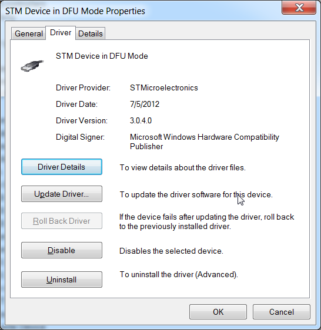
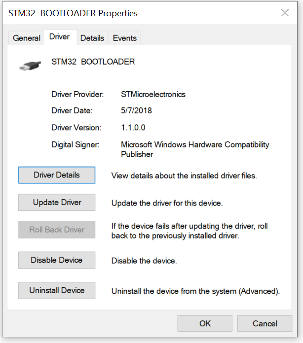

# How to Update Firmware

Disconnect it from the vehicle. Use caution.

<!-- this URL is hard-coded in rusEFI console splash screen MAKE SURE NOT TO RENAME -->

[Download the rusEFI bundle](Download) for your hardware.

## Windows

For the installed universal application, launch [rusEFI tuner](Console) from its
desktop shortcut or Windows Start menu. If you downloaded a board-specific
Release/LTS bundle, launch the application from that extracted bundle instead
to use its firmware channel. Starting the installed universal application does
not select firmware from another bundle you downloaded. Existing launcher
filenames containing `updater` or `console` are unchanged.

Choose __Update ECU Firmware__ after selecting the update mode appropriate for
your board. Check [Release vs. Snapshot](Release-Snapshot-Latest-firmware) first
if you need to remain on Release/LTS firmware rather than the installer's default
snapshot channel.

## Compare downloaded firmware

With an ECU connected, choose __Actions > Compare ECU with Downloaded
Firmware…__ in rusEFI tuner to compare it with firmware already downloaded to
your computer. This is a comparison, not a firmware update.

Check the [release channel](Release-Snapshot-Latest-firmware) before deciding
to update. The installed universal application uses snapshots by default;
launch the application from your Release/LTS bundle to use that bundle's channel.

## Linux

same steps as Windows!, the preferred path is using OpenBLT updates, not DFU

DFU is a bit dangerous. At some point we've decided not to include .DFU files into the bundles.

You will need dfu-util:

``` shell
# Debian/Ubuntu
sudo apt install dfu-util
# Arch/Manjaro
sudo pacman -Syu dfu-util
```

Once you have dfu-util, you can run this from the extracted bundle directory:

``` shell
java -jar console/rusefi_console.jar reboot_dfu

dfu-util -a 0 -D rusefi.dfu
```

## DFU mode

These days normal firmware update should be happening via more modern OpenBLT approach. We only use DFU in case of emergency. It shouldn't blink in DFU mode. When in DFU mode, we expect to see "STM32 BOOTLOADER" in device manager.


## Troubleshooting

Does blue LED close to main processor blink? If nothing is blinking after power cycle, things are pretty broken. Next step is power cycling while holding "PROG" button to enter STM32 DFU mode.

What's the status of red LED close to main processor?

## Corrupted Option Bytes

It looks like firmware versions between October 2025 and January 2026 were fragile in case of less than ideal power supply during calibration updates or firmware updates. If "STM32 BOOTLOADER" does not appear in device manager it should be there, the only next step is ST-LINK restoration via TC-2030 programming cable.

Some technical details at https://github.com/rusefi/rusefi/issues/8926

## FAQ

### Q: Device is under Read Out Protection or Target is held under reset

A: sometimes write operations glitch and lock the unit. You would need to enable DFU mode, and then run ``console\STM32_Programmer_CLI\bin\stm32-remove-read-out-protection.bat`` batch file, and then manually flash firmware in DFU mode.

*__Q:__ I got "DRIVER ERROR"*  
__A:__ In rusEFI tuner please hit "Device Manager". When ECU gets into DFU mode (blue LED stops blinking) you are expected to see a "STM32 Bootloader" device. If you see "STM device in DFU mode", please uninstall it and remove the old driver.

Bad



Good



## More Information

For more about DFU see [HOWTO-DFU](HOWTO-DFU).

ST-LINK is an advanced mode of firmware update which requires ST-LINK device, either external or built-in like on Discovery and Nucleo boards.

## Update TunerStudio Definition

Once you have updated your firmware, you also need to update your TunerStudio definition so it is able to communicate properly. A happy installation of TunerStudio will download the current .ini file automatically!

If you chose to do it manually, you can find the .ini file in the USB storage device that rusEFI board presents to your computer, or in the [rusEFI bundle](Download). You can also look it up online from the firmware signature - see [.ini Lookup Logic](INI-lookup-logic).

## Related pages

- [HOWTO DFU](HOWTO-DFU) - DFU (Device Firmware Update) mode: auto vs. manual, drivers, and troubleshooting.
- [HOWTO Flash using STM32CubeProgrammer](HOWTO-flash-using-Stm32CubeProgrammer) - advanced / last-resort flashing via STM32CubeProgrammer (DFU or ST-Link).
- [F7 Requires Full Erase](F7-requires-full-erase) - some F7 Proteus units require a full erase before a firmware update.
- [Hardware Validation Failed](HARDWARE-VALIDATION-FAILED) - diagnosing the "HARDWARE VALIDATION FAILED" startup error.
- [4chan F7 Initial Programming](4chan-F7-initial-programming) - one-time initial programming for AlphaX 4chan F7 boards.
- [Proteus F767 Programming Instructions](Proteus-F767-programming-instructions) - DFU + STM32CubeProgrammer procedure for Proteus 0.6 boards with the F767 chip.
