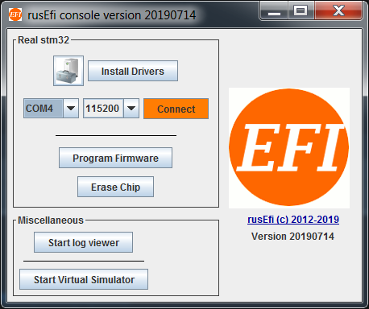

# Quick Start

This guide helps you connect to your ECU. It does not check whether the engine
is safe to start; wiring, sensors, and ignition timing need separate checks.

## Before you begin

* Check your ECU model and its instructions for power and wiring.
* For the recommended setup, use a Windows computer and USB data cable.
* Keep the engine stopped. You do not need to test outputs or change the tune to connect.

## Minimal Setup

Official units ship with firmware installed. Connect first; installing the
Windows application does not update ECU firmware.

1. [Download rusEFI tuner for Windows](https://rusefi.com/installer/rusEFI_Universal_Updater.exe)
   and start __rusEFI tuner__ from the desktop shortcut or Windows Start menu.
2. Connect your ECU over USB. The application discovers the ECU; install the
   offered drivers if needed.
3. Check that the application connects and shows ECU information. If not, see
   [Troubleshooting](Troubleshooting) before changing settings.

__You are connected when:__ rusEFI tuner shows the ECU identity and live data.
See the [rusEFI tuner guide](Console) for help with the application.

### When you are ready to change settings

Save a copy of the existing tune first. Change only settings you understand;
connecting does not mean the engine is safe to start.

Open __Tuning__ to view and edit settings. When connected, edits are sent to
live ECU RAM. __Burn to ECU__ requests saving them to persistent ECU memory;
stop the engine and confirm the save before switching power off.
__File > Save Tune__ saves a tune file on your computer instead. For logging,
use __Logging > Start__ to record a `.mlg` file, or __Start As…__ to choose its location.

## Waiting for your ECU to arrive?

Before it arrives, read your ECU's manual and installation guide. You can also
introduce yourself, describe your project, and ask questions on the
[rusEFI forums](https://rusefi.com/forum).

The Windows installer is recommended. Use the alternative workflow below only
if you need a board-specific Release/LTS bundle or its tools.

## Alternative setup: downloaded bundle or TunerStudio

Skip this section if you connected successfully with the Windows installer.

1. [Download the rusEFI bundle](Download) for your ECU and chosen firmware channel.

2. Extract the bundle and launch rusEFI tuner (the application may still be
   labeled __Console__ in some bundle contents). Use __Install Drivers__ to
   install the Virtual COM Port and DFU drivers. If necessary, the bundle will
   also help you install the Java runtime.

    

TunerStudio is an optional alternative. To use it, [install TunerStudio](HOWTO-create-tunerstudio-project#download-and-install)
and [create a project](HOWTO-create-tunerstudio-project#creating-a-project).

## Once your ECU has arrived

Connect first, then follow your board's setup instructions before preparing the
engine. If you need a firmware update, save your tune and follow
[How to Update Firmware](HOWTO-Update-Firmware). The Windows installer uses
snapshot firmware; use a Release/LTS bundle to stay on that channel.

Installing the application does not update the ECU firmware.

## Getting Your Car Running

### With a Universal ECU

Follow the [Get Running With a Universal ECU guide](HOWTO-Get-Running).

### With a Plug-and-Play ECU

Follow the [Get Running With a Plug-and-Play ECU guide](HOWTO-Get-Running-PnP).

## Tuning

See the [rusEFI tuner guide](Console#editing-settings) to edit and save settings.
Complete the installation and first-start checks first; application controls
do not replace a safe engine calibration.

If you use TunerStudio, see [Get Tuning](Get-tuning-with-TunerStudio-and-your-rusEFI).

## Logging

An engine log records readings over time. For running or cranking problems,
share the original log and tune used during recording. Screenshots or videos
alone do not show all the data.

Use the __Logging__ menu in rusEFI tuner to record a `.mlg` log, or use
TunerStudio's built-in logger if you tune with TunerStudio. For instructions
for both methods, see the [Logging Guide](Logging-Guide).

## Analyzing Logs

Start with the built-in [Log Viewer](Console#log-viewer) tab in rusEFI tuner to
open `.mlg` or `.msl` logs and inspect recorded signals. No ECU connection or
separate log-viewer installation is needed.

[EFI Analytics MegaLogViewer](https://www.efianalytics.com/MegaLogViewer/) remains
an optional professional/advanced analysis tool, not a prerequisite for beginners.

## Share Your Tunes and Logs

For engine problems, share your tune and a relevant log if you have one. If you
cannot connect or record, describe the problem and include the exact error. You
can still ask for help.

[rusEFI Online](Online) is the platform to share and compare your tune with other tunes!

## Get Support

See [Support & Community](Support)

## Want to learn more about rusEFI features?

See https://rusefi.com/docs/guide/

## FAQ

*__Q:__ How do I change settings?*  
__A:__ Beginners can change settings and their engine tune using [rusEFI tuner](Console). [TunerStudio](HOWTO-create-tunerstudio-project) is a supported professional/advanced alternative.

*__Q:__ Do I need to compile source code myself?*  
__A:__ Nope, not at all. Prebuilt bundles are available on the [Download Page](Download).

*__Q:__ I've made some changes in TunerStudio & hit Burn. 'Need Burn' has appeared but the values are not there after rusEFI reset?*  
__A:__ rusEFI does not write to internal flash memory while your engine is running. In order to really write the values into the permanent memory you would need to stop the engine (or disconnect your stimulator). Online tuning is not affected by this issue; you can tune and the new values will be applied right away, but they will not be saved until you stop the engine.

*__Q:__ I've remapped some analog inputs and outputs but nothing has changed, looks like the old pins are still used for output?*  
__A:__ For most of the pinout changes to be applied you need to reset rusEFI. Do not forget to stop the engine so that the new config is saved into internal memory!

*__Q:__ What does this error code mean?*  
__A:__ See [Error Codes](Error-Codes)
