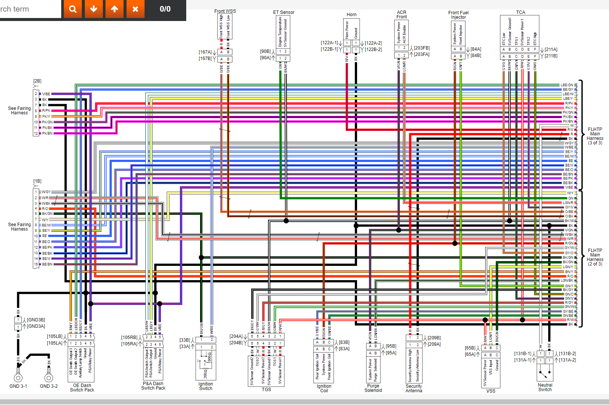
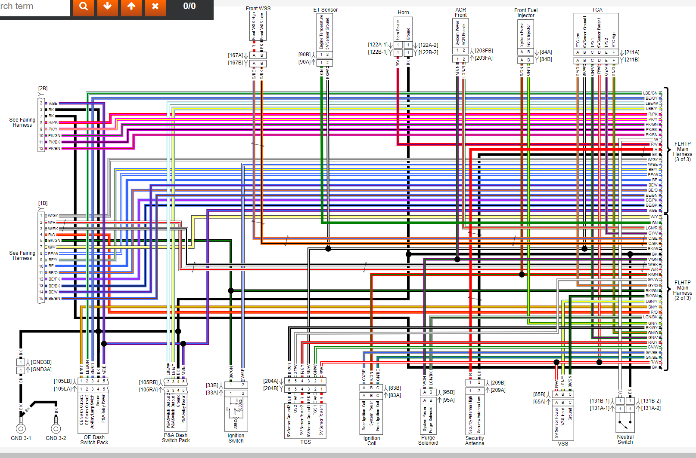
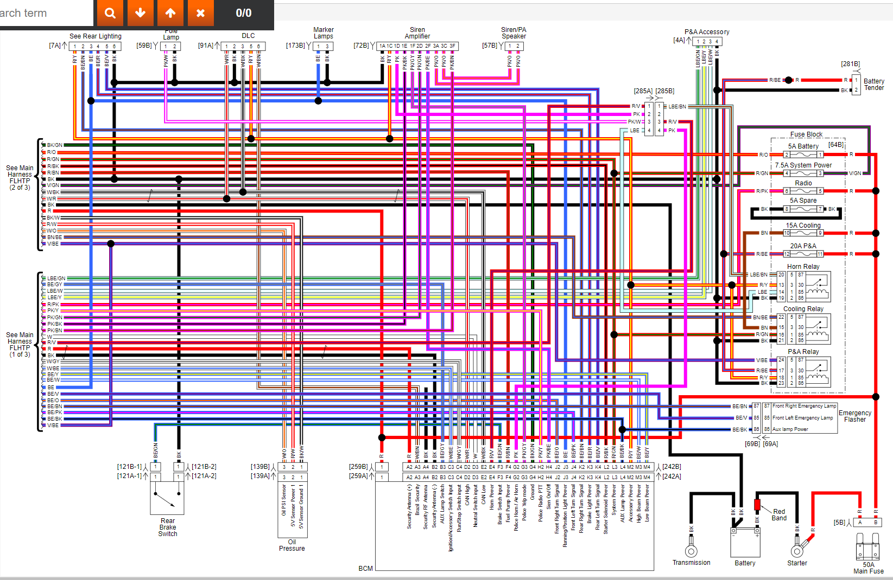
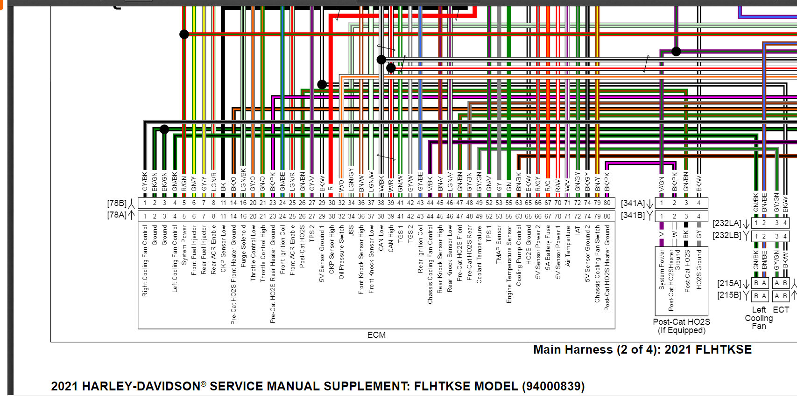

# Harley Davidson

## 2019 Police

[FLHTP main harness and BCM pinout](OEM-Docs/Harley/2019-Harley-Davidson-FLHTP-main-harness.md)

## 2021

[Touring with fairing ECM pinout](OEM-Docs/Harley/2021-Harley-Davidson-Touring-with-Fairing-ECM-pinout.md), [Touring BCM pinout](OEM-Docs/Harley/2021-2022-Harley-Davidson-Touring-BCM-pinout.md), and [fairing wiring](OEM-Docs/Harley/2021-Harley-Davidson-Touring-fairing-wiring.md)

[FLHTKSE ECM pinout](OEM-Docs/Harley/2021-Harley-Davidson-FLHTKSE-ECM-pinout.md)

## 2022 Touring with Fairing

[ECM pinout](OEM-Docs/Harley/2022-Harley-Davidson-Touring-with-Fairing-ECM-pinout.md) and [BCM pinout](OEM-Docs/Harley/2021-2022-Harley-Davidson-Touring-BCM-pinout.md)

## 2023 FLTRXSE

[ECM pinout](OEM-Docs/Harley/2023-Harley-Davidson-FLTRXSE-ECM-pinout.md) and [BCM, lighting and hand controls](OEM-Docs/Harley/2023-Harley-Davidson-FLTRXSE-body-and-hand-controls.md)

## OEM ECM photos

[Delphi case labels, connector views, and board markings](OEM-Docs/Harley/Harley-Davidson-OEM-ECM-photo-markings.md)
