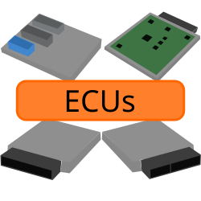
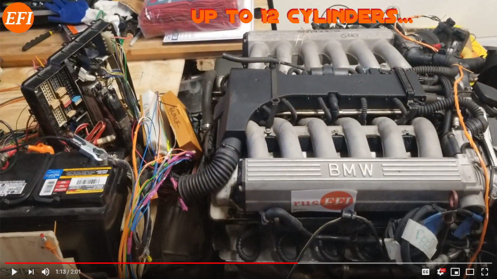

# Home

||||
|-|-|-|

Welcome to the rusEFI wiki. rusEFI is an open-source engine control system for
gasoline engines, supported by a worldwide community. Use this wiki to choose,
connect, and set up an engine control unit (ECU), or to find help.

## Get Started

| I want to… | Start here |
| --- | --- |
| Understand what I need for my project | [Getting Started roadmap](Getting-Started) |
| Choose an ECU | [Hardware overview](Hardware) and [ECU Comparison](ECU-Comparison) |
| Connect my ECU for the first time | [Quick Start](HOWTO-quick-start) |
| Download the tuning application | [Download rusEFI tuner](Download) |
| Learn the application controls | [rusEFI tuner guide](Console) |
| Set up an engine for its first start | [Universal ECU](HOWTO-Get-Running) or [plug-and-play ECU](HOWTO-Get-Running-PnP) |
| Record or review an engine log | [Logging Guide](Logging-Guide) |
| Fix a problem or ask for help | [Troubleshooting](Troubleshooting) and [Support & Community](Support) |

Start with **rusEFI tuner** for tuning and built-in log viewing. TunerStudio and
MegaLogViewer are optional alternatives. See the
[TunerStudio tuning guide](Get-tuning-with-TunerStudio-and-your-rusEFI).

Unfamiliar terms? See [Acronyms & Terminology](Vault-Of-Terminology).

The [PDF Manual](https://wiki.rusefi.com/book.pdf) covers some wiki basics. To
contribute or develop hardware, see [Help Out](HOWTO-help-rusEFI) and the
[hardware pages](Hardware). rusEFI is GPL open-source software; contributions
are welcome.

## What is rusEFI for?

| Application                  | Should I use rusEFI? |
|------------------------------|----------------------|
| Race Car                     | ✓                    |
| Snow Blower                  | ✓                    |
| Fixed Engine Application     | ✓                    |
| Science Experiment           | ✓                    |
| Emissions-controlled Vehicle | ✗                    |
| Safety Critical Application  | ✗                    |
| Manned Aircraft              | ✗                    |

## Features

| Feature                                                                                                     | Supported? |
|-------------------------------------------------------------------------------------------------------------|------------|
| [Hall, VR, CLT, TPS and all popular sensors](FAQ-Basic-Wiring-and-Connections)                              | ✓          |
| [20+ OEM Triggers Supported](All-Supported-Triggers)                                                        | ✓          |
| [TunerStudio online tuning](HOWTO-create-tunerstudio-project)                                               | ✓          |
| [Batch Injection](Injection-Modes#batch)                                                                    | ✓          |
| [Sequential Injection up to 12 cylinders](Injection-Modes#sequential)                                       | ✓          |
| [Staged Injection](Staged-Injection)                                                                        | ✓          |
| [Direct Injection](GDI-status)                                                                              | ✓          |
| [Flex Fuel](Flex-Fuel) 🌽                                                                                   | ✓          |
| [Closed Loop Fueling](Fuel-Overview#closed-loop-correction)                                                 | ✓          |
| [Acceleration Enrichment - wall wetting/fuel trip/tau factor](X-tau-Wall-Wetting)                           | ✓          |
| [Onboard Wideband Controller](Wide-Band-Sensors)                                                            | ✓          |
| [Dual AFR Signal Logging](Wide-Band-Sensors)                                                                | ✓          |
| [Sequential Ignition up to 12 cylinders](Ignition-Modes#individual-coils-sequential)                        | ✓          |
| [Wasted Spark Ignition](Ignition-Modes#wasted-spark)                                                        | ✓          |
| [Multi-Spark](Multi-Spark)                                                                                  | ✓          |
| [Electronic Throttle Body](Electronic-Throttle-Body-Configuration-Guide)                                    | ✓          |
| [CAN Bus Connectivity](CAN)                                                                                 | ✓          |
| [Bluetooth Connectivity](Bluetooth)                                                                         | ✓          |
| [Digital Dash](Digital-Dash)                                                                                | ✓          |
| [Lua Scripting](Lua-Scripting)                                                                              | ✓          |
| [Boost Control](Boost-Control)                                                                              | ✓          |
| [Launch Control](HOWTO-Launch-Control)                                                                      | ✓          |
| [Flat Shifting](Flat-Shifting)                                                                              | ✓          |
| [Antilag](Antilag)                                                                                          | ✓          |
| [Boost-by-gear](https://github.com/rusefi/rusefi/issues/2404)                                               | ✗          |
| [Traction Control](Traction-Control)                                                                        | ✓          |
| [Blending (advanced version of dual table)](Blending)                                                       | ✓          |
| [Knock Sensing & Response](knock-sensing)                                                                   | ✓          |
| [Kick Start](Kick-Start)                                                                                    | ✓          |
| [Rotary Engines](Rotary)                                                                                    | ✓          |
| [Automatic Transmission Control](Transmission-Control)                                                      | ✓          |

And many more!
The unsupported features listed here are all things that would be amazing to see! If *you* have a project that includes any of those configurations or anything else, please jump in on the forums and we can work together to make it happen! 👍

| Achievement                                                 | Results |
|-------------------------------------------------------------|---------|
| Hundreds of rusEFI units produced                           | ✓       |
| We've lost track of how many vehicles are running on rusEFI | ✓       |

## rusEFI in action

[Engines running rusEFI](Case-Studies)

[rusEFI History](rusEFI-history) - how the project got here, from a 2012 Ford Aspire test mule onwards

  
