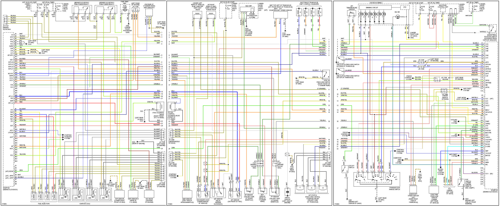
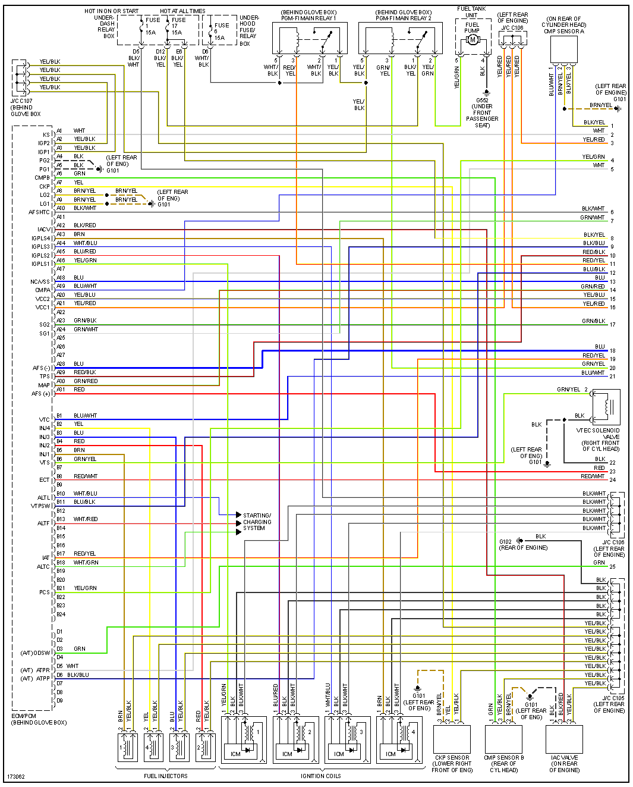
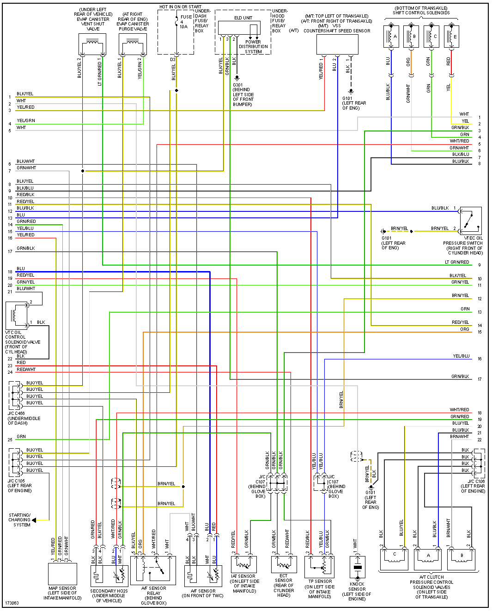
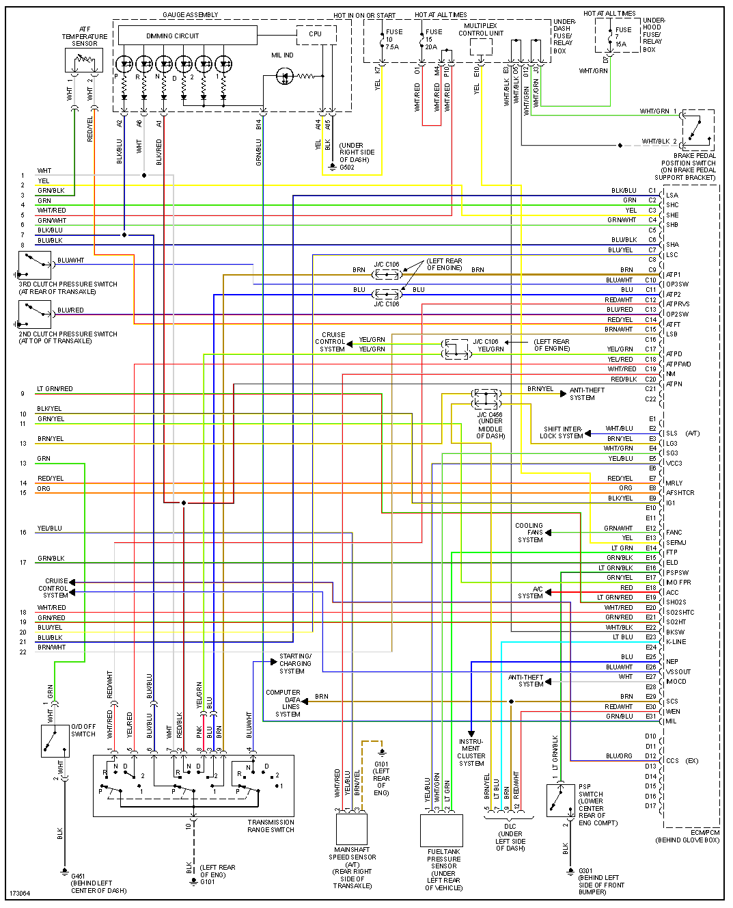
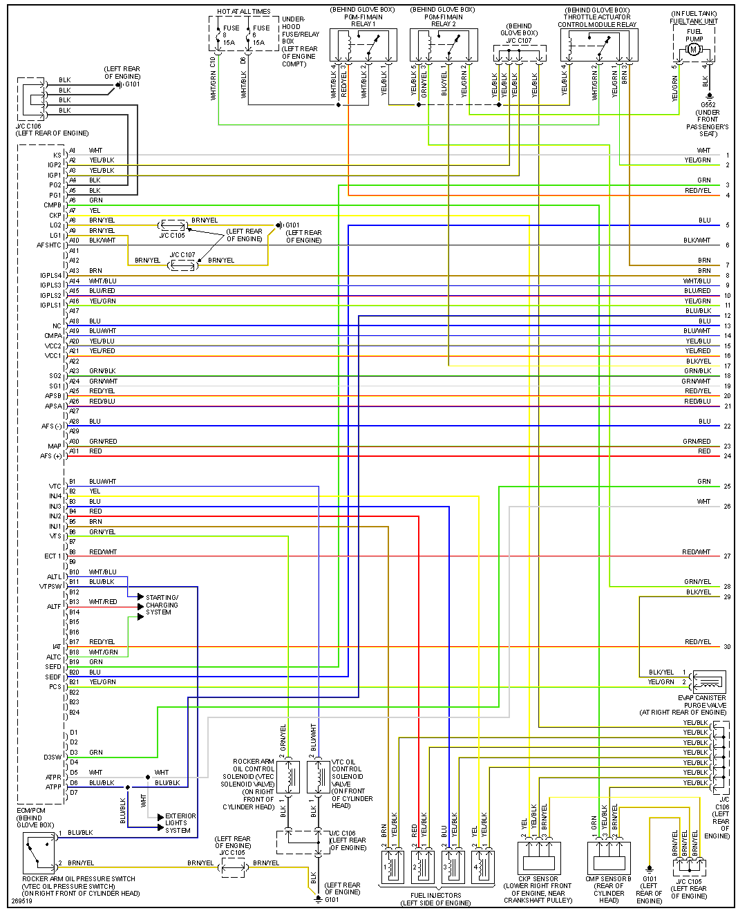
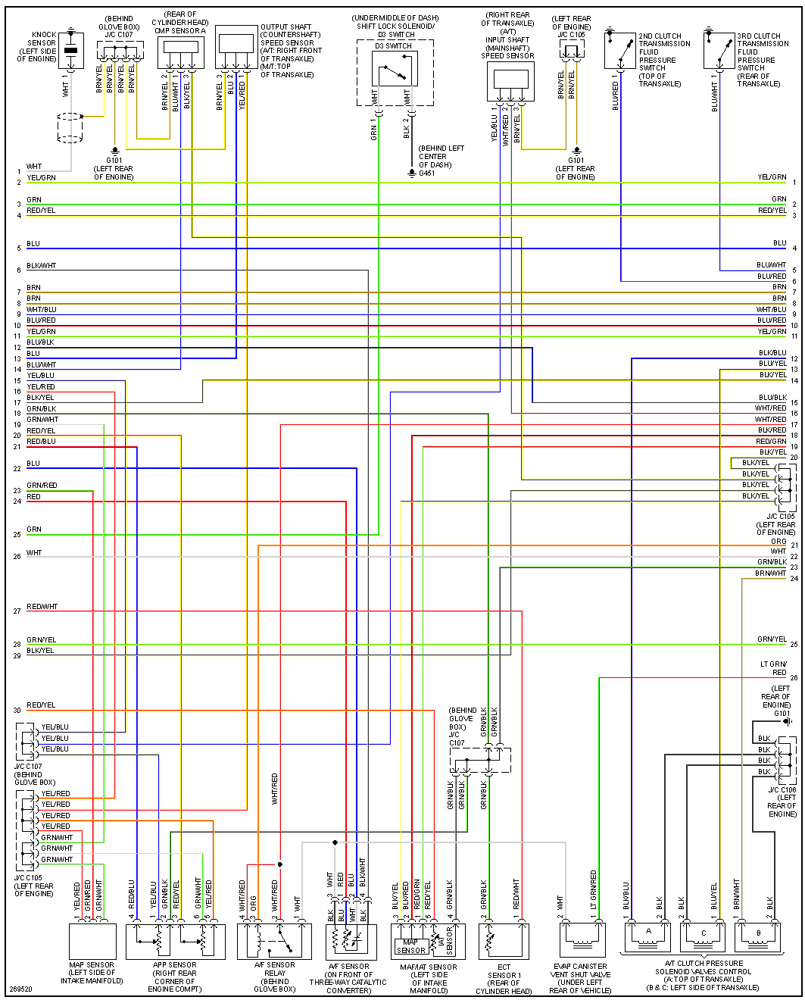
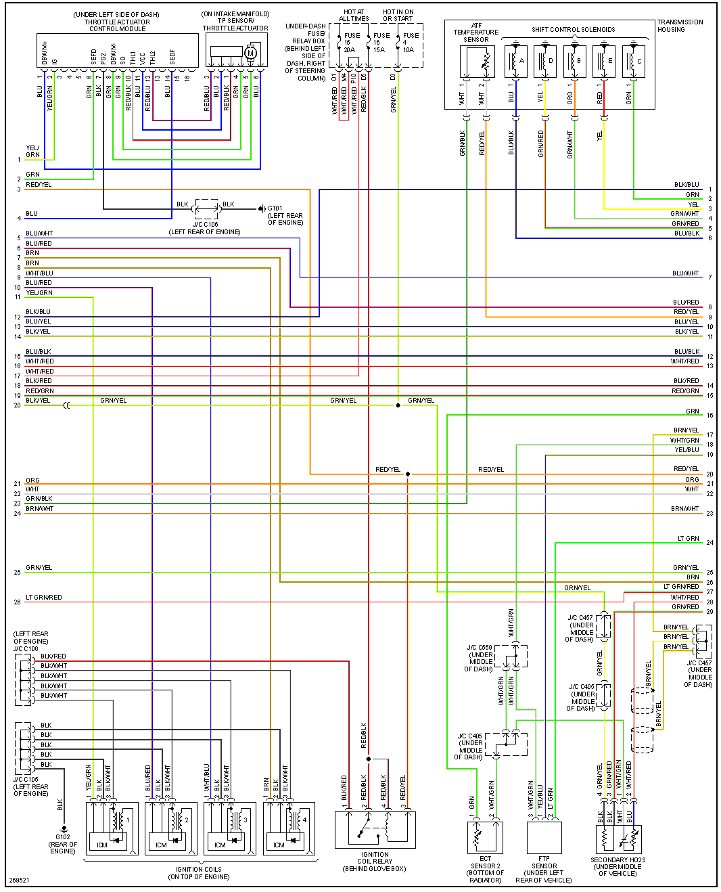
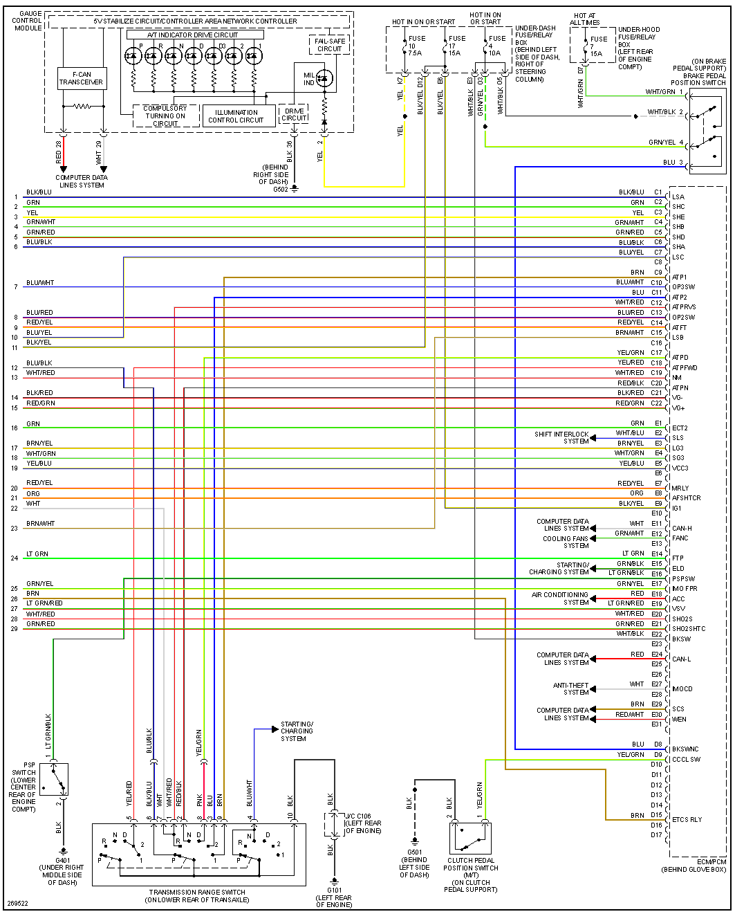

# Honda Element

[Honda Element - Wikipedia](https://en.wikipedia.org/wiki/Honda_Element)

## 2003 K24A4

[Transcribed ECM/PCM pinout](OEM-Docs/Honda/2003-Honda-Element-2.4L-ECM-pinout.md), including the E19/E20 source-label discrepancies. Compare [Honda 125-pin variations](Honda-125-variations.md).

## 2008 K24A8

[Transcribed ECM/PCM pinout](OEM-Docs/Honda/2008-Honda-Element-2.4L-ECM-pinout.md), including electronic throttle, CAN and the MAF circuit on C21/C22.

