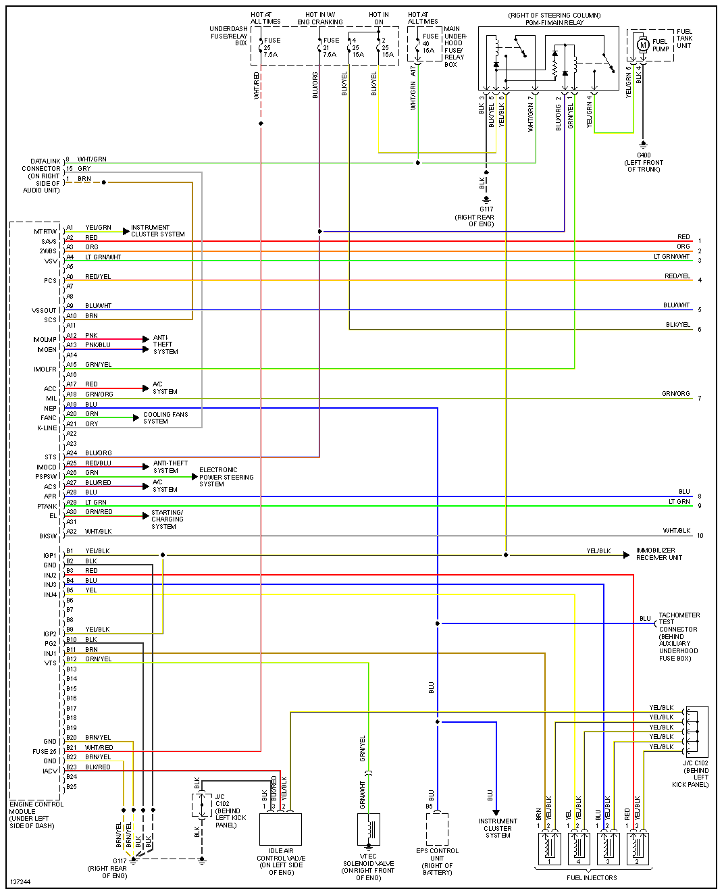
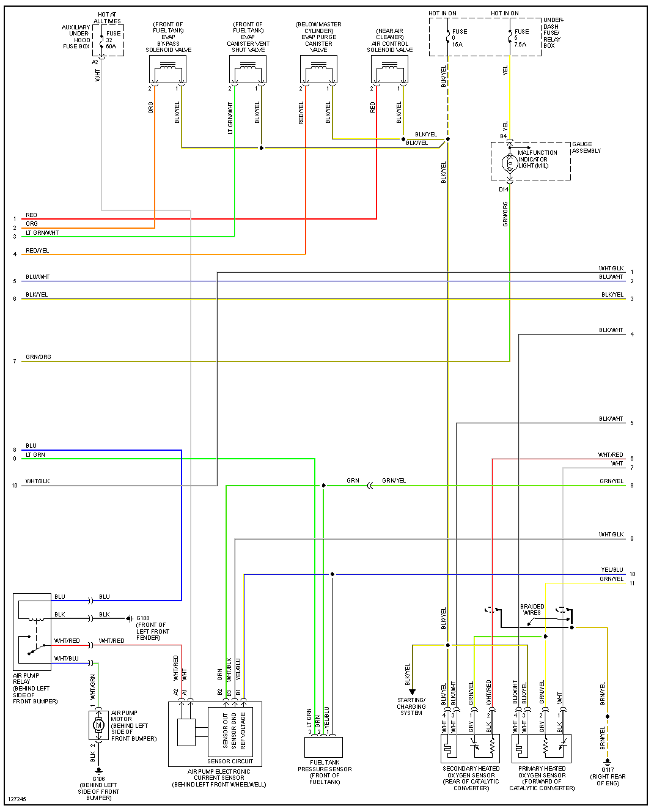
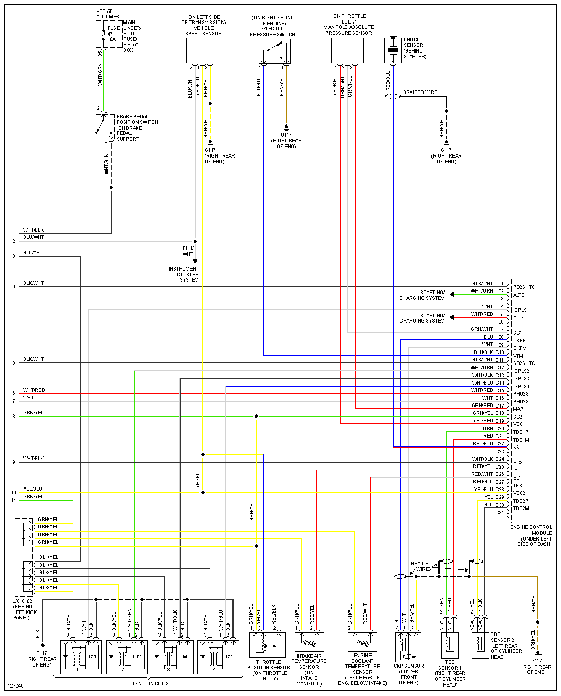

# Honda S2000

## 2001

## 2006-labelled terminal tables

[Transcribed ECM pinout and voltage/test conditions](OEM-Docs/Honda/2006-Honda-S2000-ECM-pinout.md) for connectors A/B/E of the 125-position family. The source images specify the wire side of female terminals; their filenames supply the year. This differs from the 2001 connector layout above. See [Honda 125-pin variations](Honda-125-variations.md).
