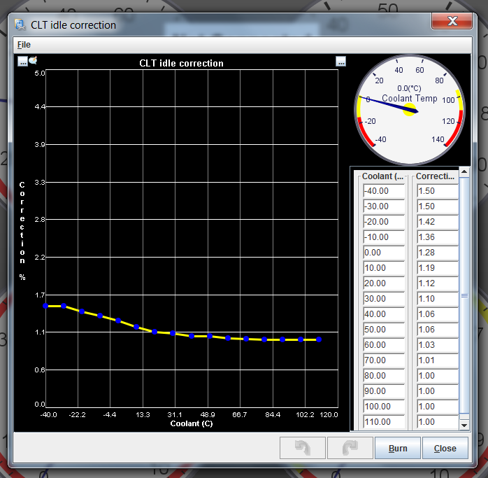

# Idle Control

rusEFI supports both solenoid-type (one or two wires; requires additional fly-back diode) and [stepper motor](Stepper-Motor) (four to six wires, add-on board required) IAC valves.

By default, idle control is in 'open-loop' mode, while in manual mode you can control the idle valve.

In the case of a stepper idle valve, the position is a percent of the total stepper steps. On startup, rusEFI moves the stepper all the way in order to find the zero position.

In the case of a solenoid valve, the percent is just the PWM duty of the control signal - it has nothing to do with the actual percentage of valve opening and you should not expect it to be linear.

## Warm-up Correction in Manual Mode

While the engine is still cold, it's good to have a bit of extra idle air; we have idle warm up correction for that. This correction adjusts the idle valve position according to the current engine coolant temperature. More air causes the engine to idle higher, but once the engine gets warmer air mass goes down and so does idle RPM.

For example, here we have 10% extra opening at 30C.

## Valve Initialization

In the case of a stepper valve, in order to get to a known position we retract the valve all the way at startup and then go to the desired position. A solenoid-based valve does not require any initialization.

## Stepper idle valve wiring

Set `useStepperIdle` when you have a stepper-motor idle valve (bipolar, usually 4-wire). rusEFI can drive a stepper in two ways:

- **Step / direction driver** — a dedicated stepper driver IC (on the board, or added via a drop-in adapter) is controlled by `stepperStepPin` and `stepperDirectionPin`. rusEFI sends step and direction signals, and the driver powers the motor coils. This is the usual method.
- **Direct coil drive** — set `useRawOutputToDriveIdleStepper`, described in the firmware as: "If enabled we use four Push-Pull outputs to directly drive stepper idle air valve coils". This drives the two coils directly from four suitable outputs (for example the H-bridges on Proteus) instead of using a step/direction driver.

Unipolar stepper valves are not supported. See the [Wiring & Connectivity Overview](FAQ-Basic-Wiring-and-Connections#idle-air-control-valve) for more on the idle valve types.

## Park/Neutral idle modifier

**Idle modifier when in P or N** (`idleParkNeutralOffset`) in the Open Loop Idle
dialog adds a signed percentage-point offset to the running idle position when
Lua reports Park or Neutral with [`setParkNeutral(true)`](Lua-Scripting#setparkneutralactive).
For example, `-5` changes a base position of 40% to 35%. Zero preserves the
existing idle behavior. The setting affects the open-loop base in both idle
modes; it does not change target RPM, the cranking curve, or the optional
dedicated coasting table. The result remains limited to 0-100%.

The Lua CAN decoder must report false for Reverse and forward gears. The state
starts false and resets to false when Lua restarts. Existing scripts that only
call `setIdleAdd` must be updated to report P/N before this setting can take
effect. Remove their old P/N offset to avoid double compensation.

## Closed-loop idle control

The `idleMode` setting chooses between two strategies:

- **Open Loop** — the idle valve position comes only from the open-loop position and its corrections (see above).
- **Open Loop + Closed Loop** — a PID controller (`idleRpmPid`) is added on top of the open-loop base to actively hold a target idle RPM. Its output is a duty cycle bounded by the PID's minimum and maximum ("Output Min/Max Duty Cycle").

Closed-loop correction only runs when the engine is actually idling. rusEFI decides this from:

- `idlePidDeactivationTpsThreshold` — "Below this throttle position, the engine is considered idling".
- `idlePidRpmUpperLimit` — "How far above idle speed do we consider idling, i.e. coasting detection threshold".
- `idlePidRpmDeadZone` — "If the RPM closer to target than this value, disable closed loop idle correction to prevent oscillation".

Configure the target idle RPM, the PID gains, and these thresholds in TunerStudio; no values are prescribed here. Tune the PID gradually and confirm behaviour on a [log](Logging-Guide).

## A/C and external idle air requests

**A/C RPM addition** adds RPM to the coolant-based target whenever A/C is
requested. For example, 100 RPM changes an 800 RPM target to 900 RPM.
**A/C Idle Air vs Pressure** supplies an eight-point air addition in percent
against pressure in kPa. Missing or invalid pressure uses the first value.
A/C air applies at idle, during the crank-to-run taper, and in the optional
coasting table. The A/C request acts before the compressor relay delay expires.

**External Idle Air Requests** provides three independent inputs, each with
an input mode and air addition. Active inputs add together with fan, Lua and
Park/Neutral corrections in the running air calculation. They do not change
the RPM target or the dedicated coasting table.

## Cranking air, flare and hold

**Use cranking air curve** is enabled by default. Its CLT curve sets the
cranking opening and blends into running air during the crank-to-run taper.
Turning it off uses running air instead.

**Cranking RPM Flare vs CLT** optionally raises the idle target during cranking
and taper. The final target also selects the running idle-air table row. When
both flare and cranking air are enabled, the cranking air curve is added to
running air and fades to zero. This combination needs its own air calibration.
Closed-loop correction remains disabled until the taper ends.

The crank-to-run page includes CLT curves for hold and taper duration. They
count engine cycles from the start of rotation, including cycles spent
cranking. A zero taper duration completes immediately when the hold ends.
Modeled-flow idle bypasses the hold, taper and RPM flare.

**Fixed ETB target during cranking** is independent of these air curves. Its
value is actual throttle percent, not percent of the ETB idle range. It applies
only while cranking below 2 km/h; missing/invalid speed is treated as zero.
At 2 km/h or above, normal pedal and idle blending applies. It does not open
the throttle on a stopped engine.

## Return to idle and moving idle

**Off-idle RPM Addition** holds an extra RPM target while running or coasting.
On return to idle, it waits until the RPM change rate falls below the stability
threshold, holds for the configured wait time, then decays linearly. Stability
is checked before the wait begins, not during the wait. Reapplying throttle
or coasting rearms it; re-cranking cancels it. Zero RPM addition disables it.
This target addition also selects the running air table row; it does not raise
the RPM thresholds that decide whether the engine is idling.

**Clutch/neutral speed-gate override** allows idle above **Max vehicle speed**
when the clutch disengages the transmission or detected gear is neutral.
Neutral remains latched through brief gear-detection matches. Opening the
throttle, exceeding the idle exit RPM, stopping/re-cranking, or returning below
the speed gate clears the latch. Configure clutch inputs or gear detection
before enabling this option. Engine-state classification need not be enabled.

## Importing an existing tune

The rusEFI tuner updater converts a fixed A/C air offset to a flat pressure curve
and preserves cranking air. It converts an absolute A/C RPM target to an
addition relative to the last (warmest) idle RPM curve point, limited to
0–1000 RPM. Review the result at other coolant temperatures: an absolute floor
and a fixed addition cannot match everywhere. Direct TunerStudio imports need
manual review of these renamed settings.

The old return-target ramp setting has no effect; use **Off-idle RPM Addition**
if required. New defaults have no TPS dashpot air addition. Explicit dashpot
values in an imported tune remain in effect.

## Technical sources

- Configuration field definitions: `firmware/integration/rusefi_config.txt` — `idleMode`, `idleRpmPid`, `idlePidDeactivationTpsThreshold`, `idlePidRpmUpperLimit`, `idlePidRpmDeadZone`, and the `idle` hardware settings (`solenoidFrequency`, `solenoidPin`, `useStepperIdle`, `stepperStepPin`, `stepperDirectionPin`, `useRawOutputToDriveIdleStepper`).
