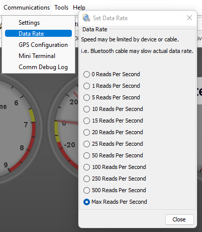
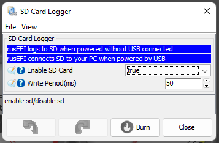
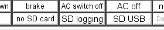
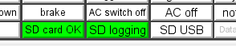
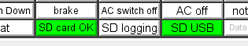

# Logging Guide

rusEFI supports multiple methods to collect logs from your ECU.

Beginners can record a `.mlg` log directly in [rusEFI tuner](Console) using
**Logging > Start**. Use **Logging > Start As…** if you want to choose the file
instead of recording into the application's logs folder. TunerStudio logging remains a supported
professional/advanced workflow; follow that section below if you use
TunerStudio. Onboard SD logging is another option on supported ECUs.

See [rusEFI tuner binary logging](Console#binary-logging) for start/stop controls
and saving the tune alongside the log.

For beginner log review, use the built-in [Log Viewer](Console#log-viewer) tab in
rusEFI tuner. It opens `.mlg` and `.msl` files without an ECU connection; you do
not need a separate MegaLogViewer installation for basic plotting and inspection.
MegaLogViewer remains an optional professional/advanced analysis tool.

The logging methods detailed here produce a `.mlg` file compatible with [MegaLogViewer](https://www.efianalytics.com/MegaLogViewer/). Field selection, timestamps and metadata differ between logging methods and firmware versions. Include the firmware version and tune when sharing a log.

If you're trying to share the log with someone to help you with your engine, please upload it to [rusEFI Online](https://rusefi.com/online).

For trigger or synchronization problems, include the tune used during the logged attempt and identify the time of the failure. Follow the [trigger evidence matrix](Trigger#evidence-matrix) to choose any additional sniffer, tooth, rusEFI tuner, or oscilloscope captures. The operating logs described here sample engine data; a tooth capture records individual input events.

## Engine state

The `Engine` log field (TunerStudio channel `engine`) is a bitmask for engine-state indicators and analyzer filters. Multiple bits can be set at once.

| Bit | Value | Meaning |
|---|---|---|
| 0 | 1 | Running, excluding cranking |
| 1 | 2 | Cranking |
| 2 | 4 | After-start fuel correction differs from 1 |
| 3 | 8 | Warmup fuel correction differs from 1 |
| 4 | 16 | TPS acceleration detection or positive adder, including its decay; in MAP Prediction mode, prediction is active |
| 5 | 32 | TPS deceleration detection or negative adder, or DFCO is cutting fuel |
| 6/7 | 64/128 | Unused MAP-rate acceleration/deceleration flags |

MAP Prediction is TPS-triggered, so it uses bit 4. Wall-wetting correction is independent and is not included in these flags. This state field differs from `Engine Mode`, which describes the configured fuel, injection and ignition algorithms.

The field is available in TunerStudio logs and ECU SD-card logs with matching firmware and INI definitions. Its presence alone does not add filters to VE Analyze or repair other WUE Analyze settings.

## TunerStudio logging

TunerStudio logging is a supported option for tuning and debugging. It requires
having a PC plugged in while logging; if you tune in rusEFI tuner, its Binary
Logging feature can record a `.mlg` file instead.

### Start/Stop Logging

1. In the menu bar, press `Data Logging` -> `Start Logging`, and pick a file name for your log (the default is the date/time), and press save. The log is now being saved by TunerStudio. The "Data Logging" indicator at the bottom of the TS dashboard should light up green.
2. Do whatever thing you want a log of. If there's a specific behavior you're getting help with, a concise, specific log is much easier to interpret than a long and complicated one.
3. To stop logging, go back to the menu bar and press `Data Logging` -> `Stop`. Closing TunerStudio or starting a new log file will also stop any running log.

### Logging Data Rate

rusEFI is capable of feeding data to TunerStudio several hundred times per second, so TS lets you select the sample rate as desired. For most purposes, 100 Hz is suitable. When looking at trigger sync or some other high-speed need, set the rate to "Max reads per second"; this shouldn't hurt ECU performance but will make a humongous log file pretty quickly.

The data rate should default to 100 Hz when using rusEFI, but it's worth checking that it's set to a speed appropriate for your application. That said, storage is cheap, so it doesn't really hurt to have it set faster than you need.

## Internal SD Card

Some rusEFI ECUs support logging to a microSD card directly. This is useful for when you don't have a PC around. Maybe you're busy driving around a racetrack!

To enable it, find the "SD Card Logger" menu under the "Controller" section (far right). Set "Enable SD Card" to true to start logging. Set how often the log should be written: the default is every 50 ms, i.e. 20 times per second (20 Hz).

### Storage Consumption

rusEFI SD logging is thorough, but not too heavy when compared to the size of cheaply available SD cards. Expect about 20 MB/hr when set to the default 50 ms period, with consumption scaling linearly with logging rate. 20 MB/hr means 50 hr/GB, or ~400 hours (2.4 weeks!) with an 8 GB card.

### Past Diagnostic Codes

With SD enabled, `past-codes.csv` keeps up to eight unique diagnostic codes,
oldest first. Each line contains the numeric `ObdCode` value and its first-seen
Unix timestamp in seconds, separated by a comma, with no header. The timestamp
field is empty if the ECU has no valid RTC time, for example `123,`.

The ECU loads this history at startup. Repeating a retained code does not change
its timestamp or rewrite the file. A new code is appended; if eight codes are
already stored, it replaces the oldest. Clearing active warnings does not clear
this history. Updates work even when regular logging is paused, but wait while
the SD card is exposed to a PC over USB.

### SD Card USB Connection

When connected to a PC, rusEFI ECUs will function as an SD card reader, allowing you to transfer logs to your PC. However, since the SD card can't be both connected to your PC and used for logging by rusEFI, the following logic is used to decide which to do:

- ECU first powered by the car, USB never connected: SD card logging mode
- ECU first powered by the car, USB later connected: SD card logging mode
- ECU first powered by USB: SD card reading mode

If you're unsure what the SD card is currently doing, have a look at the three SD card-related indicators in TunerStudio:

No SD card detected:

SD card logging mode:

SD card reading mode:

The assumption is that if you have USB connected, you will be logging using TunerStudio instead of the onboard SD card.

See also [SD Card](User-Support-SD-card)
