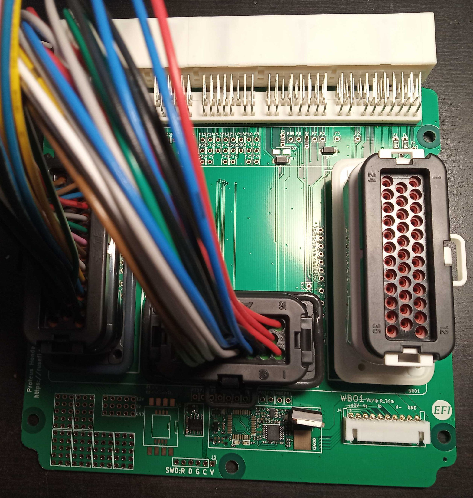

# Honda 125 pin Proteus Adapter

See [Honda 125-pin variations and transcribed OEM pinouts](Honda-125-variations.md) before matching a harness to this adapter. For example, RSX VTEC changes from B15 (2002–04) to B6 (2005–06), and A9 changes from knock input to logic ground. The connector alone does not identify the wiring.

[Proteus Honda K 125 Adapter](https://github.com/rusefi/proteus-Honda-K-125-adapter)

[Schematics rev A](https://github.com/rusefi/proteus-Honda-K-125-adapter/blob/main/proteus125honda/boards/proteus125honda-a/board/proteus125honda-a-schematic.pdf)

[Connector Pinout Spreadhseet, with links to wiring drawings](https://docs.google.com/spreadsheets/d/1G6FDarE99hbd0HSs6bh5kEkZy6p-kYTxa0NcJpE1HUc)

[Proteus Manual](Proteus-Manual)

[see also Hellen-125-Honda-K](Hellen-125-Honda-K)

