# SUPERSEAL Adapters

## Index by pin count

Adapters are sorted by the OEM vehicle pin count. Where the board uses a larger connector, the added AUX (auxiliary) sections and total connector size are shown separately. AUX sections require additional wiring; they are not part of the factory harness.

- [Mazda Miata NA 1.6 / 1994–1995 1.8 — 48 OEM + 16 AUX (64 total)](#mazda-miata-na--48-pins)
- [Mazda Miata NA8 1.8 / 1996–1997 — 64 OEM + 12 AUX (76 total)](#mazda-miata-na8--64-pins)
- [Mazda Miata NB1 1.8 / 1999–2000 — 64 OEM + 12 AUX (76 total)](#mazda-miata-nb1--64-pins)
- [Nissan Sentra SR20DE — 64 pins](#nissan-64-sentra-sr20de)
- [Mazda Miata NB2 1.8 — 72 OEM + 50 AUX (122 total)](#mazda-miata-nb2--72-pins)
- [Suzuki G13BB — 72 pins](#suzuki-72-g13bb)
- [Nissan Skyline GTS-T ECR33 — 76 pins](#nissan-76-skyline-gts-t-ecr33)
- [BMW Motronic M50/M50TU, M60 and early S50 — 88 pins](#bmw-88--motronic-m3x)
- [Mitsubishi Mirage — 119 pins](#mitsubishi-mirage)
- [Mazda Miata NC — 120 pins](#mazda-miata-nc)
- [Toyota Supra A80 — 120 pins](#toyota-120-supra-a80)
- [Nissan Xterra VQ40DE / Armada VK56DE — 121 pins](#nissan-121-xterra-vq40de-armada-vk56de)
- [VAG Bosch ME7 — 121 pins](#vag-121--bosch-me7)
- [Toyota Aristo JZS161 — 122 pins](#toyota-122-aristo-jzs161)
- [Honda K-series / Acura RSX — 125 pins](#honda-k--125-pins)
- [Subaru Impreza WRX / WRX STI — 135 pins](#subaru-135-impreza-wrx-wrx-sti)
- [Kawasaki Ninja ZX-4R reference — 136 pins](#kawasaki)
- [BMW N52 — 146 pins](#bmw-146---n52--msv80)
- [Ford Mustang Coyote — 198 pins](#ford-198--mustang-coyote)

## BMW

### BMW 88 — Motronic M3.x

The BMW Motronic 88 Superseal adapter connects the 88-terminal vehicle harness to Superseal 60 + 34 connectors and includes eight ignition power drivers.

- **BMW M50/M50TU, M60 and early S50 with Bosch Motronic M3.1/M3.3/M3.3.1.** Reference applications are the 1994 BMW 325i M50TU and 1994 BMW 540i M60. Check the exact DME and engine-specific pin assignments; Siemens MS40/MS41 is outside this adapter's scope.
- **Ignition:** Eight onboard power drivers for stock coils, with optional bypasses for compatible 5 V smart coils. Never populate a driver and its bypass together.

[📄 Adapter schematics (PDF)](https://github.com/rusefi/rusefi_documentation/blob/master/Hardware-files/adapters/BMW-88-adapter/BMW-88-superseal-adapter.pdf)

[🚗 Vehicle pinout 🚗](https://rusefi.com/docs/pinouts/bmw88/) | [🔌 Adapter board pinout 🔌](https://rusefi.com/docs/pinouts/bmw88-adapter/)

[Reference wiring — 1994 325i M50TU, sheet 1](OEM-Docs/Bmw/1994_e36/94_325_1.png) · [sheet 2](OEM-Docs/Bmw/1994_e36/94_325_2.png) | [Reference wiring — 1994 540i M60, early, sheet 1](OEM-Docs/Bmw/1994_e34/94_540_early_1.png) · [sheet 2](OEM-Docs/Bmw/1994_e34/94_540_early_2.png) · [sheet 3](OEM-Docs/Bmw/1994_e34/94_540_early_3.png)

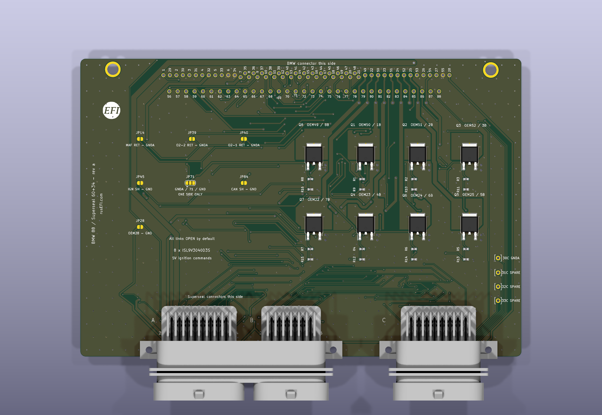

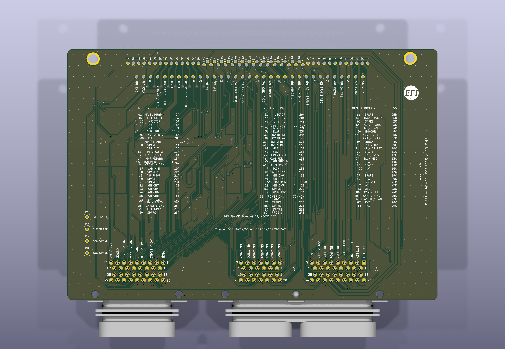

### BMW 146 - N52 / MSV80

The BMW N52 Superseal adapter connects the seven-section, 146-terminal vehicle interface to Superseal 60 + 34 + 26 connectors.

- **Reference application: 2011 BMW 328i Sedan (E90), 3.0L N52K.** Check the exact DME and harness against the pinouts for other N52 vehicles; a matching connector alone does not establish compatibility.
- **Ignition:** Passive adapter; stock coils in the reference wiring require ECU power outputs or external ignition drivers.
- [BMW N52 documentation and ECU cable guides](BMW-N52.md)

[📄 Adapter schematics (PDF)](https://github.com/rusefi/rusefi_documentation/blob/master/Hardware-files/adapters/BMW-N52-adapter/BMW-N52-146-superseal.pdf)

[🚗 Vehicle pinout 🚗](https://rusefi.com/docs/pinouts/BMW-N52-146/) | [🔌 Adapter board pinout 🔌](https://rusefi.com/docs/pinouts/BMW-N52-adapter/)

[Reference wiring - 2011 BMW 328i N52](https://github.com/rusefi/rusefi_documentation/blob/master/OEM-Docs/Bmw/2011%20BMW%20328i%20n52.pdf) | [Reference terminal tables](OEM-Docs/Bmw/2011-BMW-328i-E90-N52K-ECU-pinout.md)

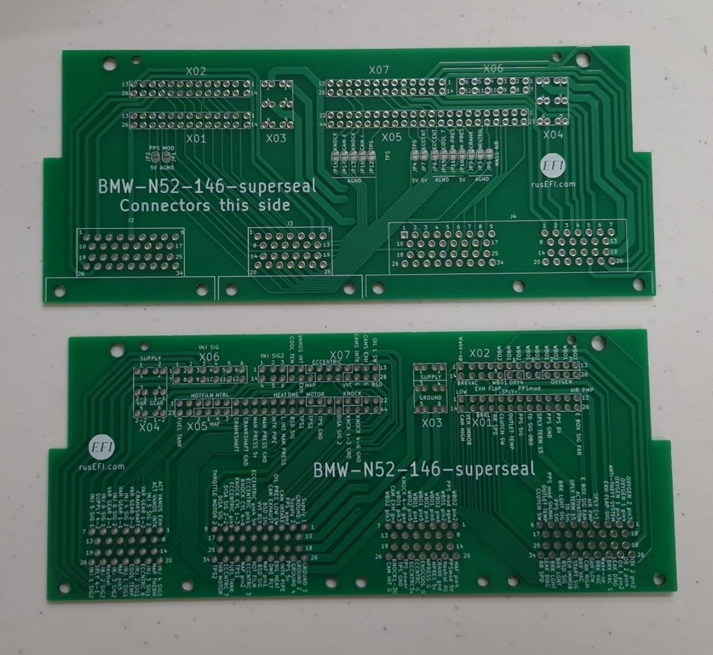

## Ford

[Ford ECU schematic transcription index](OEM-Docs/Ford/README-ford.md)

### Ford 198 — Mustang Coyote

The Ford Mustang 198 Superseal adapter connects the 198-pin vehicle harness (103-pin and 95-pin sections) to 60-pin and 34-pin Superseal connectors.

- **2015 and 2016 Mustang 5.0L Coyote:** closest reference wiring matches to revision 0.2, with C175B (103 pins) and C175E (95 pins). The power, ground, injector and ignition assignments below agree with the adapter. This comparison does not establish a tested model-year range or complete plug-and-play compatibility.
- **2016 and 2020 Mustang 5.2L naturally aspirated:** 198-terminal references with different injector, ignition and auxiliary assignments; require remapping. The 2020/2022 supercharged GT500 references use 309 terminals and are outside this adapter layout.
- **Ignition:** revision 0.2 includes eight ignition-driver circuits. The Superseal side carries logic-level ignition inputs; the vehicle side carries power outputs to the coil primaries when the drivers are populated. Check the assembly configuration against the schematics.

[📄 Adapter schematics (PDF)](https://github.com/rusefi/rusefi_documentation/blob/master/Hardware-files/adapters/Ford-Mustang-198-adapter/Ford-mustang-198-superseal-adapter.pdf)

[🚗 Vehicle pinout 🚗](https://rusefi.com/docs/pinouts/hellen/coyote/) | [🔌 Adapter board pinout 🔌](https://rusefi.com/docs/pinouts/Ford-Mustang-198-adapter/)

[Reference wiring — 2015 Mustang 5.0L](https://github.com/rusefi/rusefi_documentation/blob/master/OEM-Docs/Ford/2015-mustang-v8.pdf) | [Reference pinout — connector A](https://github.com/rusefi/rusefi_documentation/blob/master/OEM-Docs/Ford/Coyote-175b-pinout-A.png) | [Reference pinout — connector B](https://github.com/rusefi/rusefi_documentation/blob/master/OEM-Docs/Ford/Coyote-175e-pinout-B.png)

The adapter schematic calls the 103-pin vehicle section **A** and the 95-pin section **B**. In the Mustang 5.0L diagrams these correspond to **C175B** and **C175E**, respectively. The comparison below uses the OEM connector names.

| Reference | Connector layout | Result |
|---|---|---|
| [2015 Mustang 5.0L](OEM-Docs/Ford/2015-Ford-Mustang-5.0-PCM-pinout.md) | C175B 103 + C175E 95 | Closest match: power/ground and all eight injector and coil assignments agree. The PDF's V6/3.7L export header conflicts with its V8 circuitry; see the transcription's scope note. |
| [2016 Mustang 5.0L](OEM-Docs/Ford/2016-Ford-Mustang-5.0-PCM-pinout.md) | C175B 103 + C175E 95 | Same matching core assignments. Printed upstream oxygen-sensor bank labels differ from the adapter at E-50/E-51; verify sensor routing and auxiliary circuits. |
| [2016 Mustang 5.2L](OEM-Docs/Ford/2016-Ford-Mustang-5.2-PCM-pinout.md) | C175B 103 + C175E 95 | Related layout; injector and coil assignments differ as listed below. |
| [2020 Mustang 5.2L naturally aspirated](OEM-Docs/Ford/2020-Ford-Mustang-5.2-naturally-aspirated-PCM-pinout.md) | C1381B 103 + C1381E 95 | Same injector/coil differences as the 2016 5.2L reference. Connector identification differs; mechanical fit/keying is not established by these circuit diagrams. |

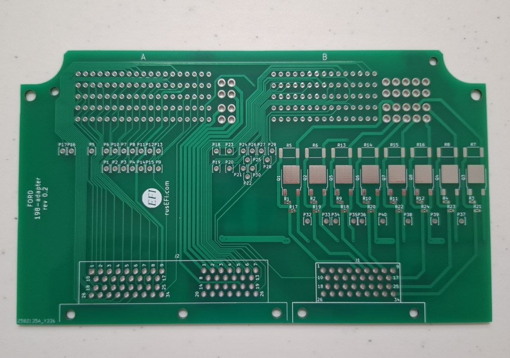

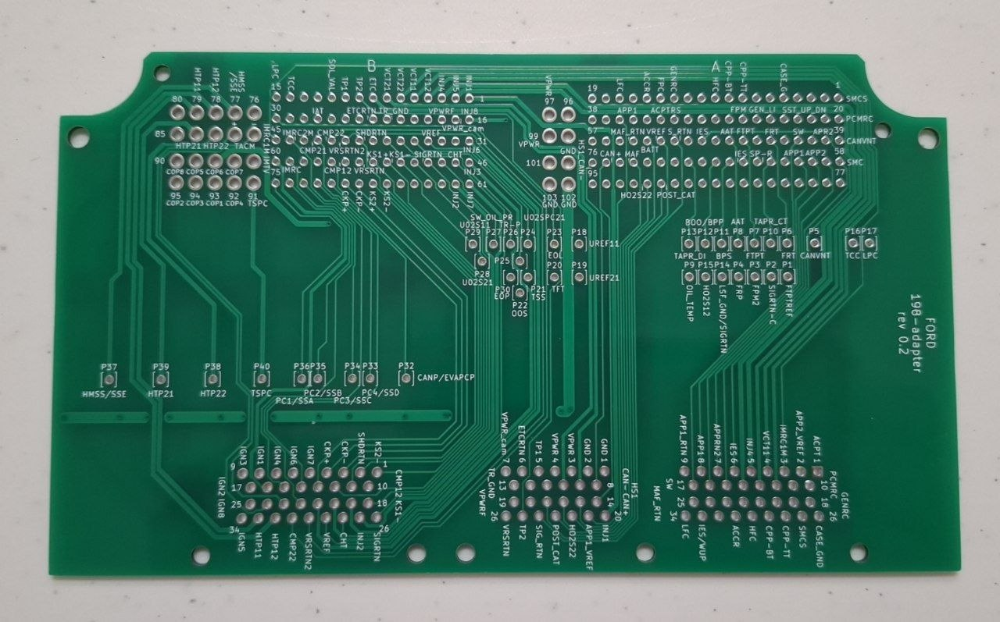

## Honda

### Honda K — 125 pins

Passive adapter for Honda K-series engines with 2002–2004 Acura RSX wiring, based on Hellen125Honda. The TE 1318612-1 vehicle connector connects to Superseal 60+26 (1A–34A, 1B–26B and 1C–26C); the remaining vehicle contacts have individual solder access pads.

Connector C uses the Hellen auxiliary assignments, not the factory automatic-transmission wiring. The 2005–2006 RSX pinout is different.

[📄 Adapter schematics (PDF)](https://github.com/rusefi/rusefi_documentation/blob/master/Hardware-files/adapters/Honda-K-125-adapter/Honda-K-125-superseal-adapter.pdf)

[🚗 Vehicle pinout 🚗](https://rusefi.com/docs/pinouts/Honda-K-125/) | [🔌 Adapter board pinout 🔌](https://rusefi.com/docs/pinouts/Honda-K-125-adapter/)

[Reference wiring — Acura RSX (2003)](OEM-Docs/Honda/2003-acura-rsx-type-R.pdf) | [OEM terminal table — 2002–2004 / 2005–2006 comparison, page 1](OEM-Docs/Honda/rsx-ecu-pinouts-02-06_page1.jpg) · [page 2](OEM-Docs/Honda/rsx-ecu-pinouts-02-06_page2.jpg)

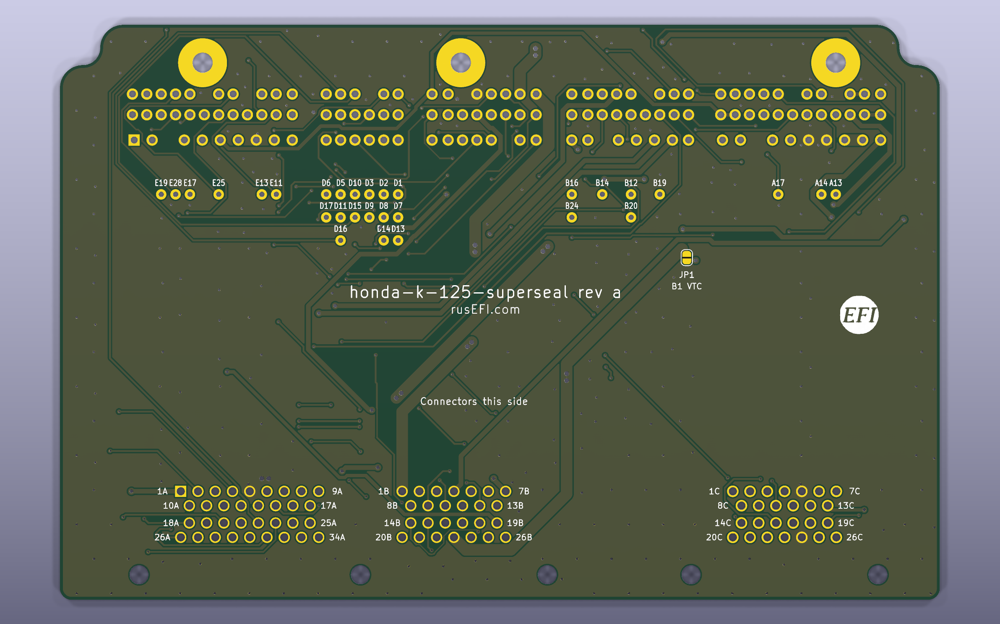

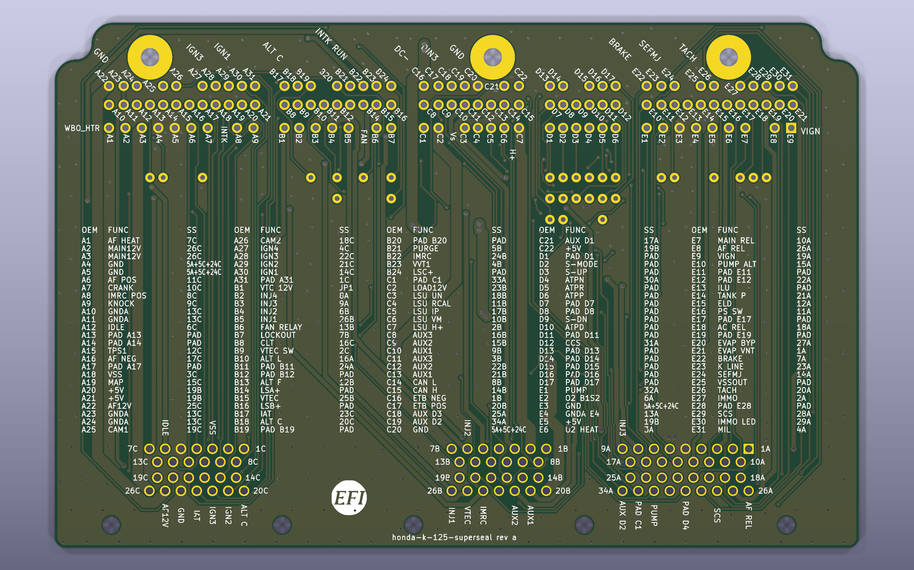

## Kawasaki

136 pin like Ninja ZX-4R and similar

[Reference wiring — Ninja ZX-4R service manual, chapter 17](https://github.com/rusefi/rusefi_documentation/blob/master/OEM-Docs/Kawasaki/Ninja%20ZX-4R%20Service%20Manual.pdf)

## Mazda

### Mazda Miata NA — 48 OEM + 16 AUX (64 total)

The Miata NA adapter uses a **64-position TE 176122-6** connector: **48 OEM contacts** in the two factory ECU plugs (22 + 26), plus **16 AUX contacts** in the added middle section 2. The AUX section provides additional sensor, wideband, VVT and boost-control connections. The ECU side is one Superseal 60 connector.

- **1990–1993 Mazda MX-5 / Miata NA6, 1.6L; 1994–1995 Mazda MX-5 / Miata NA, 1.8L.** Reference wiring: 1990 and 1994 US models. Match ECU-side harness assignments to the actual year, transmission and vehicle wiring.
- **Load supply:** Superseal 14B receives the ECU's protected 5 A output. JP1 supplies the optional wideband heater; JP2/R1 provide the optional tachometer pull-up. Assignments are in the pinouts and schematics.

[📄 Adapter schematics (PDF)](https://github.com/rusefi/rusefi_documentation/blob/master/Hardware-files/adapters/Mazda-Miata-NA-adapter/Mazda-Miata-NA-superseal-adapter.pdf)

[🚗 OEM and AUX pinout 🚗](https://rusefi.com/docs/pinouts/miata-na/) | [🔌 Adapter board pinout 🔌](https://rusefi.com/docs/pinouts/miata-na-adapter/)

[Reference wiring — 1990 Miata 1.6](OEM-Docs/Mazda/1990_Miata/1990_mazda_miata_us_wiring.png) | [Reference wiring — 1994 Miata 1.8, sheet 1](Images/diagrams/1994_miata_1.8_1.png) · [sheet 2](Images/diagrams/1994_miata_1.8_2.png)

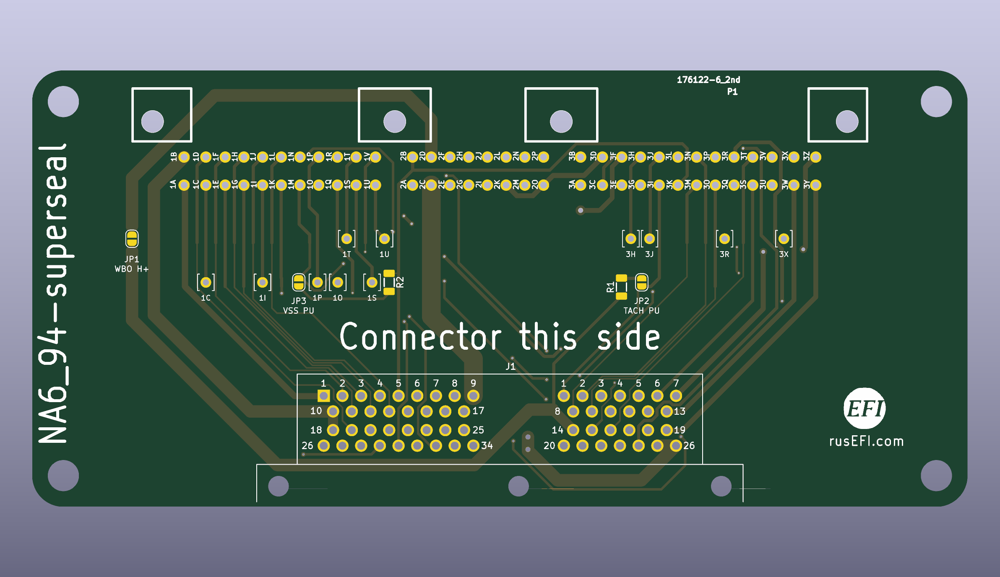

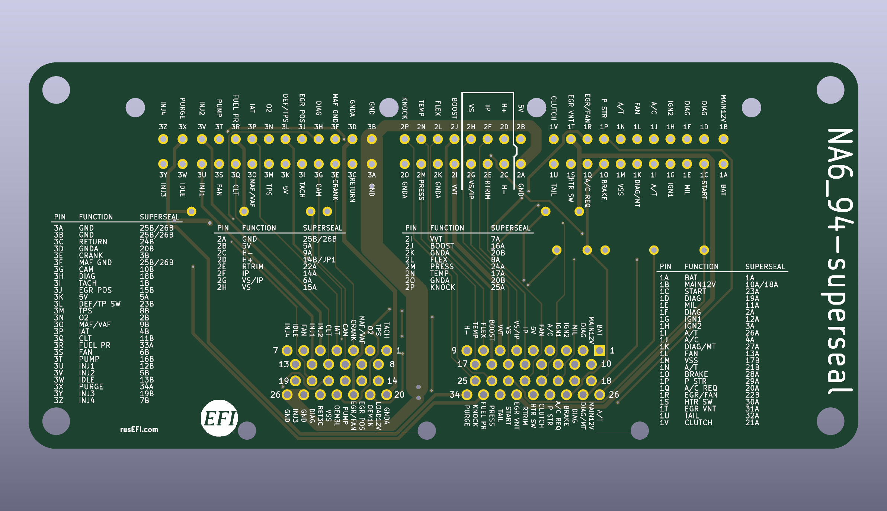

### Mazda Miata NA8 — 64 OEM + 12 AUX (76 total)

The Miata NA8 adapter uses a **76-position TE 178780-1** connector: **64 OEM contacts** in the three factory ECU plugs (22 + 16 + 26), plus **12 AUX contacts** in the added section 2. The AUX section provides additional sensor, wideband, VVT and boost-control connections. The ECU side is Superseal 60 + 26.

- **1996–1997 Mazda MX-5 / Miata NA8, 1.8L BP.** The pinouts use the 1996 and 1997 US wiring diagrams.

[📄 Adapter schematics (PDF)](https://github.com/rusefi/rusefi_documentation/blob/master/Hardware-files/adapters/Mazda-Miata-NA8-adapter/Mazda-Miata-NA8-superseal-adapter.pdf)

[🚗 OEM and AUX pinout 🚗](https://rusefi.com/docs/pinouts/miata-na8/) | [🔌 Adapter board pinout 🔌](https://rusefi.com/docs/pinouts/miata-na8-adapter/)

[Reference wiring — 1996 Miata 1.8, sheet 1](Images/diagrams/1996_miata_1.8_1.png) · [sheet 2](Images/diagrams/1996_miata_1.8_2.png) | [Reference wiring — 1997 Miata 1.8](https://www.mellens.net/mazda/Mazda-Miata-1997/wiring.pdf)

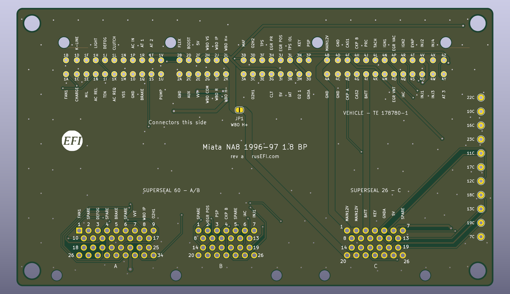

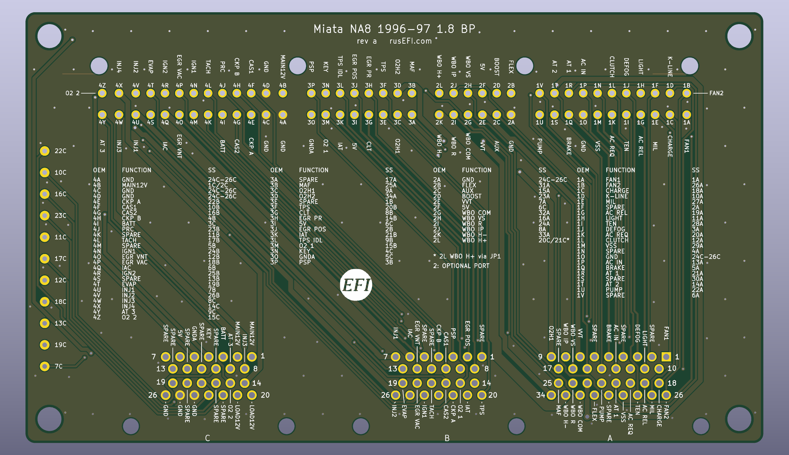

### Mazda Miata NB1 — 64 OEM + 12 AUX (76 total)

The Miata NB1 adapter uses a **76-position TE 178780-1** connector: **64 OEM contacts** in the three factory ECU plugs (22 + 16 + 26), plus **12 AUX contacts** in the added section 4. The AUX section provides additional sensor, wideband, VVT and boost-control connections. The ECU side is Superseal 60 + 26.

- **1999–2000 Mazda MX-5 / Miata NB1, 1.8L BP.** The pinouts use the US wiring diagrams.

[📄 Adapter schematics (PDF)](https://github.com/rusefi/rusefi_documentation/blob/master/Hardware-files/adapters/Mazda-Miata-NB1-adapter/Mazda-Miata-NB1-superseal-adapter.pdf)

[🚗 OEM and AUX pinout 🚗](https://rusefi.com/docs/pinouts/miata-nb1/) | [🔌 Adapter board pinout 🔌](https://rusefi.com/docs/pinouts/miata-nb1-adapter/)

[Reference wiring — 1999 Miata](Images/diagrams/Mazda_miata_1999.png) | [Reference wiring — 2000 Miata](https://www.mellens.net/mazda/mazda_miata_extra_manual/2000_wiring.pdf) | [Service manual](https://www.mellens.net/mazda/Mazda-Miata-1999-2001.pdf)

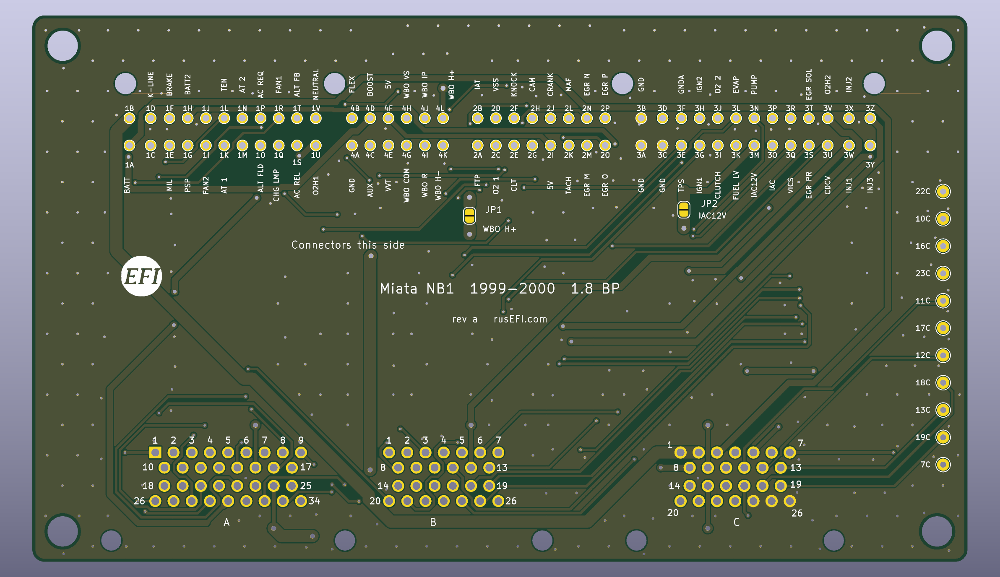

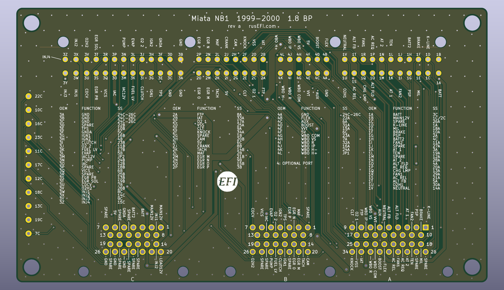

### Mazda Miata NB2 — 72 OEM + 50 AUX (122 total)

The Miata NB2 adapter uses a **122-position TE 8-5353015-1** connector: **72 OEM contacts** in factory sections 2–4 (17 + 24 + 31), plus **50 AUX positions** in the added sections 1 (22) and 5 (28). The AUX sections provide additional sensor, wideband and actuator connections. Of those 50 positions, 32 connect to Superseal or access pads; the other 18 in section 1 are unused. The ECU side is Superseal 60 + 26.

- **2001–2005 Mazda MX-5 / Miata NB2, naturally aspirated 1.8L BP engine with VVT:** intended application. The pinouts use the 2003 US wiring diagram and identify 2002 differences. Check the year, market and transmission against the reference wiring; Mazdaspeed turbo wiring differs.
- **Load supply:** Superseal 24C–26C receive the ECU's protected 5 A output. The five solder jumpers select which loads receive this supply; their assignments are in the pinouts and schematics.

[📄 Adapter schematics (PDF)](https://github.com/rusefi/rusefi_documentation/blob/master/Hardware-files/adapters/Mazda-Miata-NB2-adapter/Mazda-Miata-NB2-superseal-adapter.pdf)

[🚗 OEM and AUX pinout 🚗](https://rusefi.com/docs/pinouts/miata-nb2/) | [🔌 Adapter board pinout 🔌](https://rusefi.com/docs/pinouts/miata-nb2-adapter/)

[Reference wiring — 2003 Miata 1.8](OEM-Docs/Mazda/2003_Miata/Mazda_miata_2003.png) | [Reference wiring — 2002 Miata 1.8](Images/diagrams/Mazda_miata_2002.png)

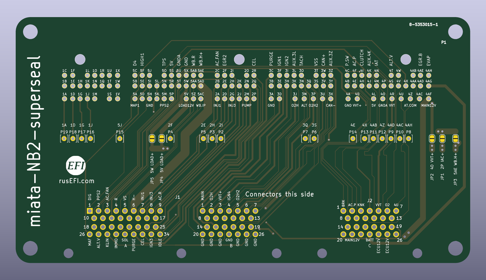

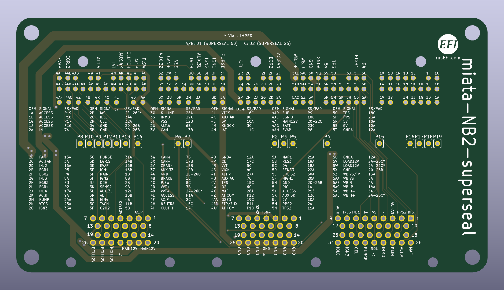

### Mazda Miata NC

The Mazda Miata NC Superseal adapter connects the 120-pin vehicle harness (two 60-pin connectors) to 60-pin and 26-pin Superseal connectors.

- **Mazda MX-5 / Miata NC:** intended application. The adapter is listed as not yet tested on a vehicle. Check the harness version against the vehicle pinout and adapter schematics.

[💲Buy Mazda Miata NC💲](https://www.shop.rusefi.com/shop/p/mazda-miata-nc-superseal-adapter) | [📄 Adapter schematics (PDF)](https://github.com/rusefi/rusefi_documentation/blob/master/Hardware-files/adapters/Mazda-Miata-NC-adapter/Mazda-Miata-NC-superseal-adapter.pdf)

[🚗 Vehicle pinout 🚗](https://rusefi.com/docs/pinouts/miata-nc/) | [🔌 Adapter board pinout 🔌](https://rusefi.com/docs/pinouts/miata-nc-adapter/)

[Reference wiring — 2009 MX-5 NC2](https://github.com/rusefi/rusefi_documentation/blob/master/OEM-Docs/Mazda/2009%20NC2.pdf) | [Reference terminal voltages — 2009 MX-5 NC2](https://github.com/rusefi/rusefi_documentation/blob/master/OEM-Docs/Mazda/2009%20NC2%20Pin%20Voltages.pdf)

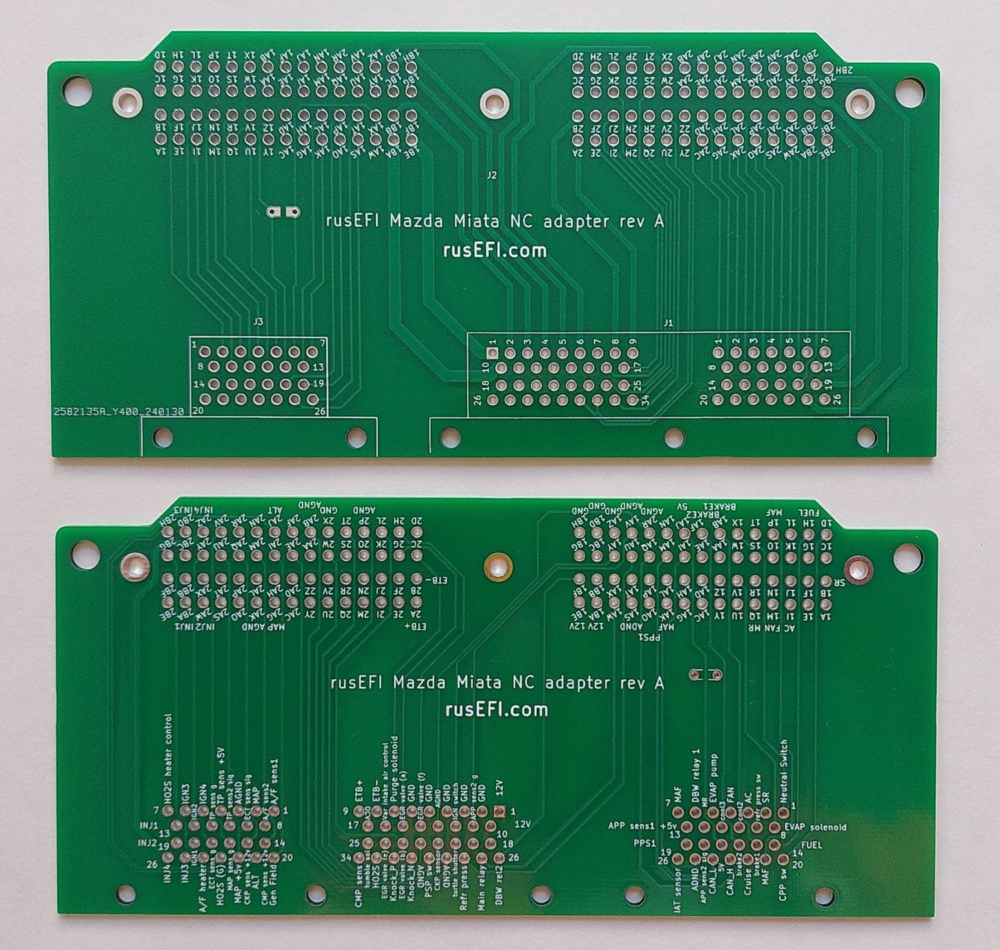

## Mitsubishi

### Mitsubishi Mirage

The Mitsubishi Mirage Superseal adapter connects the 119-contact vehicle connector to a 60-pin Superseal connector, routing 50 contacts.

- **Mitsubishi Mirage 1.2L:** intended application. The vehicle pinout follows the 2014 Mirage ES reference. Check the exact harness and equipment; a tested model-year range has not been established.

[📄 Adapter schematics (PDF)](https://github.com/rusefi/rusefi_documentation/blob/master/Hardware-files/adapters/Mitsubishi-Mirage-adapter/Mitsubishi-Mirage-superseal-adapter-0.3.pdf)

[🚗 Vehicle pinout 🚗](https://rusefi.com/docs/pinouts/Mitsubishi-Mirage/) | [🔌 Adapter board pinout 🔌](https://rusefi.com/docs/pinouts/Mitsubishi-Mirage-adapter/)

[Reference wiring — 2014 Mirage](https://github.com/rusefi/rusefi_documentation/blob/master/OEM-Docs/Mitsubishi/2014-mirage.pdf) | [Reference wiring — 2020 Mirage](https://github.com/rusefi/rusefi_documentation/blob/master/OEM-Docs/Mitsubishi/2020-mirage.pdf)

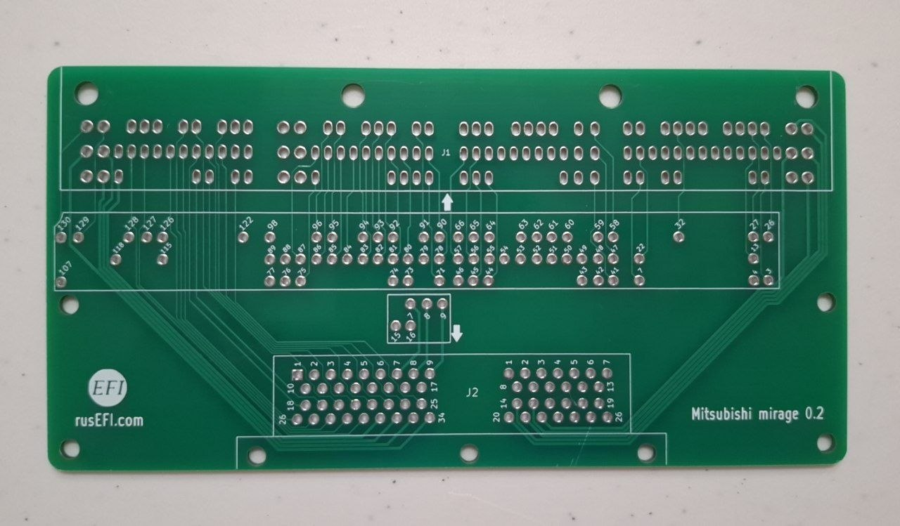

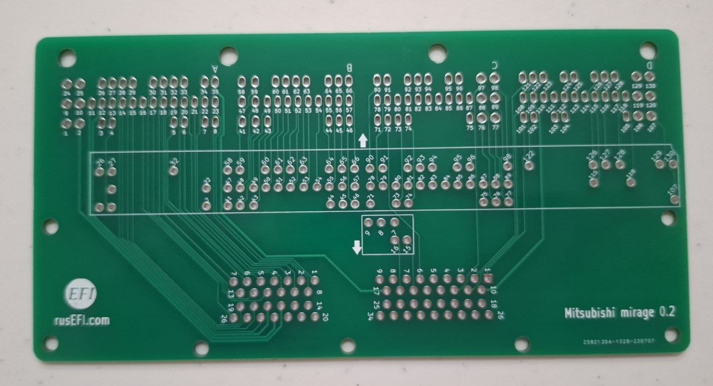

## Nissan

### Nissan 64 — Sentra SR20DE

The Nissan 64 Superseal adapter connects the early 64-terminal E.C.C.S. vehicle connector (terminals 1–48 and 101–116) to a 60-pin Superseal connector (1A–34A and 1B–26B).

- **1993 Nissan Sentra 2.0L SR20DE:** reference application. The wiring diagram includes manual/automatic transmission and equipment variants; check the exact harness against the pinouts and schematics. Vehicle operation has not been validated.
- **Other Nissan applications with a 64-terminal connector:** compatibility is not established by connector shape alone. Functions not identified in the reference are marked as such in the pinouts.

[📄 Adapter schematics (PDF)](https://github.com/rusefi/rusefi_documentation/blob/master/Hardware-files/adapters/Nissan-64-adapter/Nissan-64-superseal-adapter.pdf)

[🚗 Vehicle pinout 🚗](https://rusefi.com/docs/pinouts/nissan64/) | [🔌 Adapter board pinout 🔌](https://rusefi.com/docs/pinouts/nissan64-adapter/)

[Reference wiring — 1993 Sentra SR20DE](https://github.com/rusefi/rusefi_documentation/blob/master/OEM-Docs/Nissan/1993%20Nissan-Datsun%20Sentra%202.0%20ECU.pdf)

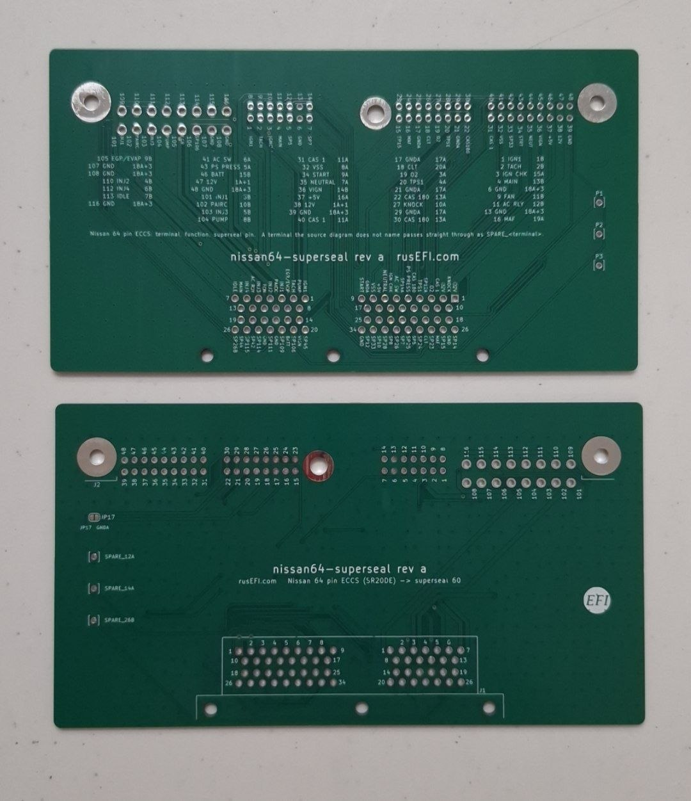

### Nissan 76 — Skyline GTS-T ECR33

The Nissan 76 Superseal adapter connects the 76-pin vehicle harness to a 60-pin Superseal connector.

- **Nissan Skyline GTS-T ECR33, RB25DET:** intended application. Check the harness version against the vehicle pinout and adapter schematics.

[💲Buy Nissan 76💲](https://www.shop.rusefi.com/shop/p/superseal-nissan-76) | [📄 Adapter schematics (PDF)](https://github.com/rusefi/rusefi_documentation/blob/master/Hardware-files/adapters/Nissan-76-adapter/Nissan76-superseal-adapter.pdf)

[🚗 Vehicle pinout 🚗](https://rusefi.com/docs/pinouts/nissan76/) | [🔌 Adapter board pinout 🔌](https://rusefi.com/docs/pinouts/nissan-76-adapter/)

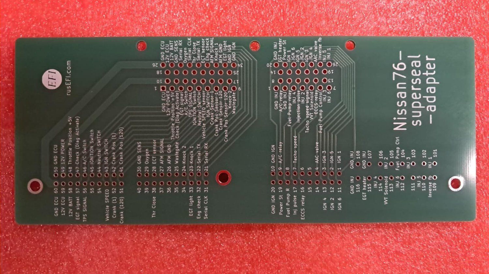

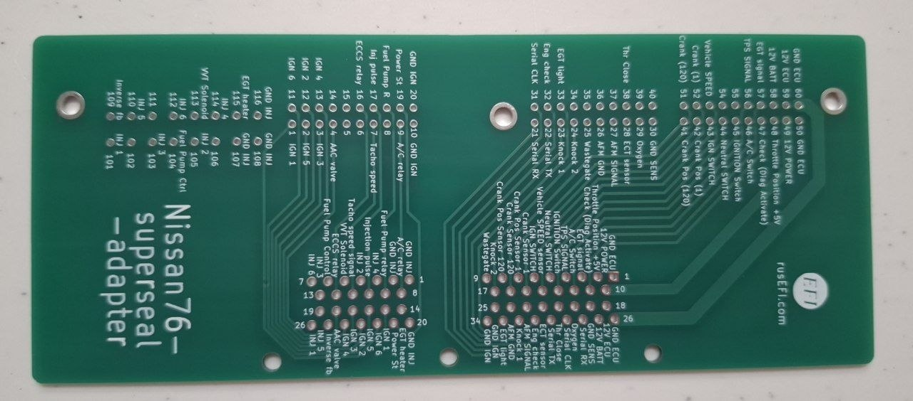

### Nissan 121 — Xterra VQ40DE / Armada VK56DE

The Nissan 121 Superseal adapter connects the 121-pin vehicle harness (TE 368255-2) to 60-pin and 26-pin Superseal connectors (1A–34A, 1B–26B and 1D–26D).

- **2011 Nissan Xterra 4.0L VQ40DE and 2011 Nissan Armada 5.6L VK56DE:** reference applications. The pinouts identify engine-specific functions. Vehicle operation has not been validated.
- **Related Nissan/Infiniti applications:** a matching 121-pin connector alone does not establish compatibility. Check the exact engine, model year and wiring against the [Nissan 121 variations](Nissan-121-variations.md) before using this adapter.

[📄 Adapter schematics (PDF)](https://github.com/rusefi/rusefi_documentation/blob/master/Hardware-files/adapters/Nissan-121-adapter/Nissan-121-superseal-adapter.pdf)

[🚗 Vehicle pinout 🚗](https://rusefi.com/docs/pinouts/nissan121/) | [🔌 Adapter board pinout 🔌](https://rusefi.com/docs/pinouts/nissan121-adapter/)

[Reference wiring — 2011 Xterra VQ40DE](https://github.com/rusefi/rusefi_documentation/blob/master/OEM-Docs/Nissan/2011_Xterra/2011_Xterra_ECU.png) | [Reference wiring — 2011 Armada VK56DE](https://github.com/rusefi/rusefi_documentation/blob/master/OEM-Docs/Nissan/2011%20Nissan-Datsun%20Truck%20Armada%204WD%20ECU.pdf)

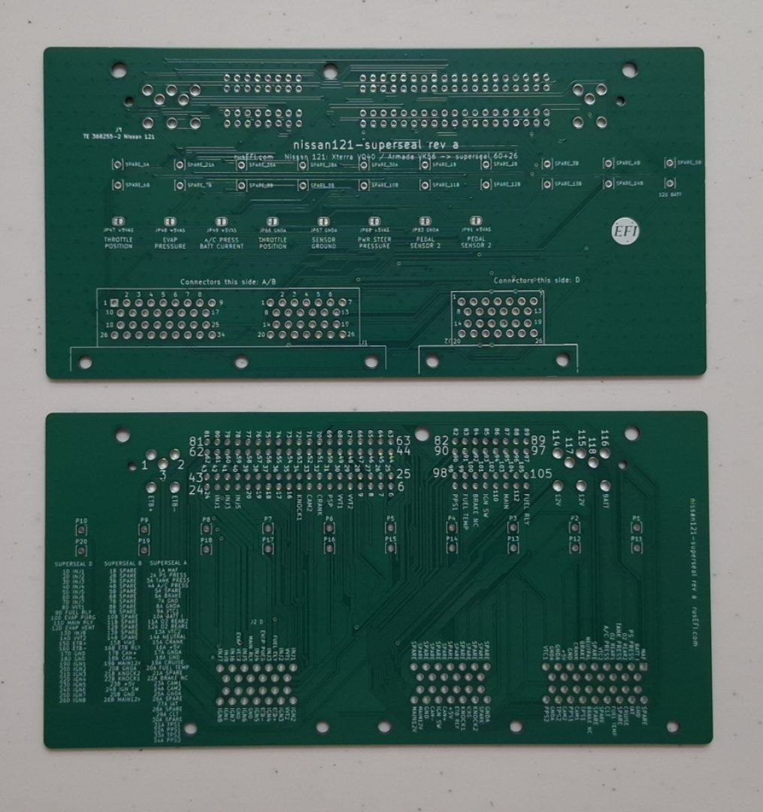

## Subaru

### Subaru 135 — Impreza WRX / WRX STI

The Subaru 135 Superseal adapter connects the four-section 135-pin vehicle harness to 60-pin, 34-pin and 26-pin Superseal connectors. It routes 110 contacts.

- **Subaru Impreza WRX / WRX STI with the 135-pin ECM connector:** intended application. The vehicle pinout follows the 2013 WRX EJ255 reference with SI-Drive. Check the specific harness before installation; compatibility across the previously listed 2011–2021 range has not been established.
- **2017 WRX STI EJ257:** use the STI references to check differences. Contact 6-4 is part of the neutral-position switch circuit, whereas the 2013 WRX pinout identifies it as ground. Do not ground it or close JP3 for that STI circuit. Starter wiring also differs between key and push-button versions.

[📄 Adapter schematics (PDF)](https://github.com/rusefi/rusefi_documentation/blob/master/Hardware-files/adapters/Subaru-135-adapter/Subaru-135-superseal-adapter.pdf)

[🚗 Vehicle pinout 🚗](https://rusefi.com/docs/pinouts/subaru-2011/) | [🔌 Adapter board pinout 🔌](https://rusefi.com/docs/pinouts/subaru%20adapter/)

[Reference wiring — 2013 WRX](https://github.com/rusefi/rusefi_documentation/blob/master/OEM-Docs/Subaru/2013%20Subaru%20Impreza%20WRX.pdf) | [Reference wiring — 2017 WRX STI](https://github.com/rusefi/rusefi_documentation/blob/master/OEM-Docs/Subaru/2017%20Subaru%20WRX%20STI.pdf) | [STI starting — key](https://github.com/rusefi/rusefi_documentation/blob/master/OEM-Docs/Subaru/2017%20Subaru%20WRX%20STI-starting-with-key.pdf) | [STI starting — push button](https://github.com/rusefi/rusefi_documentation/blob/master/OEM-Docs/Subaru/2017%20Subaru%20WRX%20STI-starting-with-push-button.pdf)

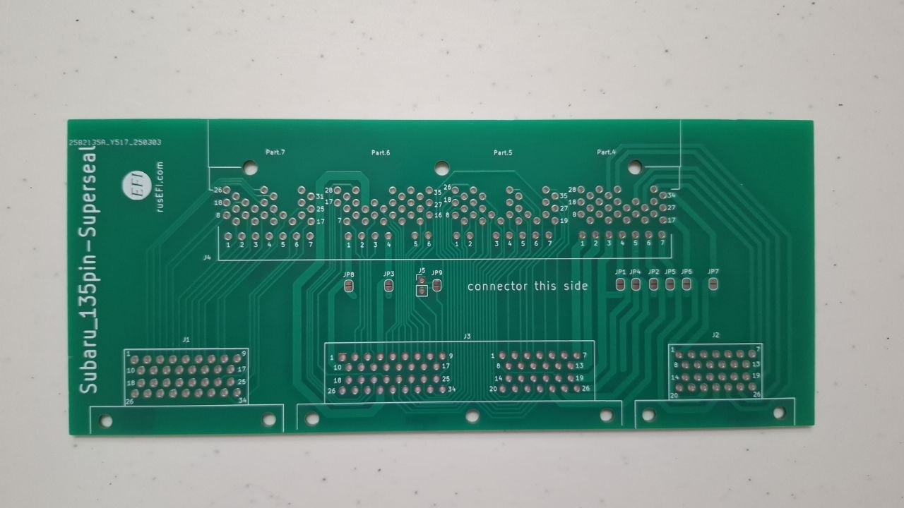

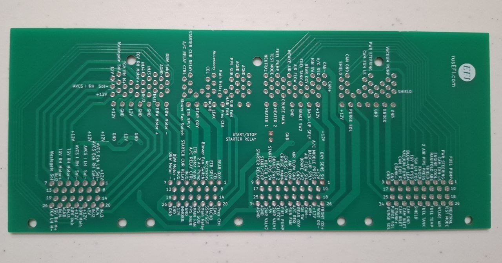

## Suzuki

### Suzuki 72 — G13BB

The Suzuki 72 Superseal adapter connects a 72-terminal vehicle connector (31+24+17 sections) to one 60-terminal Superseal connector (1A–34A and 1B–26B). It routes 34 vehicle terminals to 32 Superseal contacts; the remaining terminals have individual solder access pads.

- **Engine: Suzuki G13BB, with a 72-terminal ECU connector.** The reference pinout includes Samurai-specific notes. Check the exact harness against both pinouts and the schematics; a tested vehicle/model-year range has not been established.
- **Configuration:** revision a has four open solder jumpers for configurable ground connections. Follow the [connection and configuration instructions](Suzuki-72-adapter.md) before installation.

[📄 Adapter schematics (PDF)](https://github.com/rusefi/rusefi_documentation/blob/master/Hardware-files/adapters/Suzuki-72-adapter/Suzuki-72-superseal-adapter.pdf)

[🚗 Vehicle pinout 🚗](https://rusefi.com/docs/pinouts/suzuki72/) | [🔌 Adapter board pinout 🔌](https://rusefi.com/docs/pinouts/suzuki72-adapter/)

[Reference wiring — Jimny workshop manual, pages 614–619 (comparison; assignments differ)](https://www.carmanualsonline.info/suzuki-jimny-2005-3-g-service-workshop-manual/62)

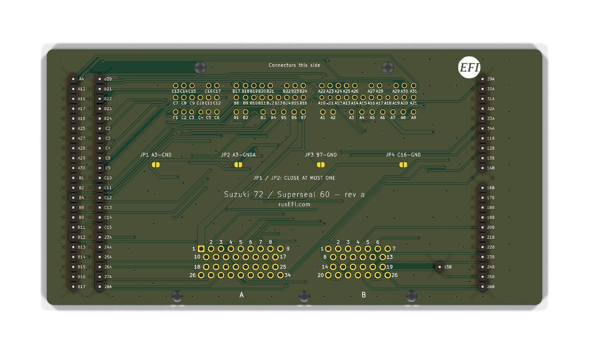

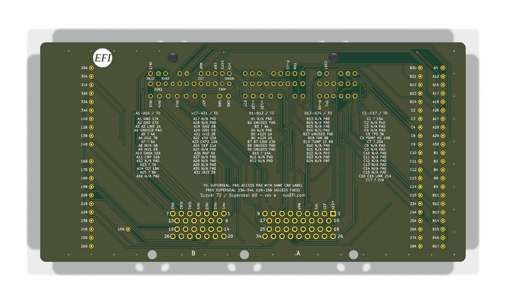

## Toyota

### Toyota 120 — Supra A80

The Toyota 120 Superseal adapter connects the 120-pin vehicle harness to 60-pin and 26-pin Superseal connectors.

- **Toyota Supra A80 (Mk IV), 2JZ-GTE:** intended application. The adapter is listed as untested. Check the harness version against the vehicle pinout and adapter schematics.

[💲Buy Toyota 120💲](https://www.shop.rusefi.com/shop/p/superseal-toyota-120) | [📄 Adapter schematics (PDF)](https://github.com/rusefi/rusefi_documentation/blob/master/Hardware-files/adapters/Toyota-120-adapter/Toyota-120-superseal.pdf)

[🚗 Vehicle pinout 🚗](https://rusefi.com/docs/pinouts/Toyota-JZA80/) | [🔌 Adapter board pinout 🔌](https://rusefi.com/docs/pinouts/Toyota-120-adapter/)

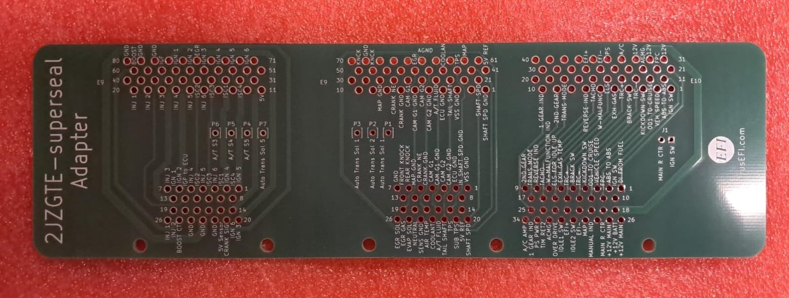

### Toyota 122 — Aristo JZS161

The Toyota 122 Superseal adapter connects the 122-pin vehicle harness to 60-pin and 26-pin Superseal connectors.

- **Toyota Aristo JZS161, 2JZ-GTE VVT-i:** intended application. Check the harness version against the vehicle pinout and adapter schematics; a fully tested model-year range has not been established.
- **Lexus GS300 S160, 2JZ-GE:** related application, compared against the 1998 wiring diagram. Pin functions differ from Aristo, so wiring verification is required; plug-and-play compatibility is not confirmed.

[💲Buy Toyota 122💲](https://www.shop.rusefi.com/shop/p/superseal-toyota-122) | [📄 Adapter schematics (PDF)](https://github.com/rusefi/rusefi_documentation/blob/master/Hardware-files/adapters/Toyota-122-adapter/Toyota-122-superseal.pdf)

[🚗 Vehicle pinout 🚗](https://rusefi.com/docs/pinouts/Toyota-JZS161/) | [🔌 Adapter board pinout 🔌](https://rusefi.com/docs/pinouts/jza161-adapter/)

[Reference wiring — 1998 Lexus GS300 (2JZ-GE; differs from Aristo)](https://github.com/rusefi/rusefi_documentation/blob/master/OEM-Docs/Toyota/1998%20Lexus%20GS300%20ECU%20Wiring%20Diagram.pdf)

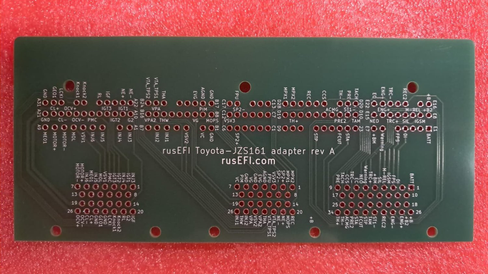

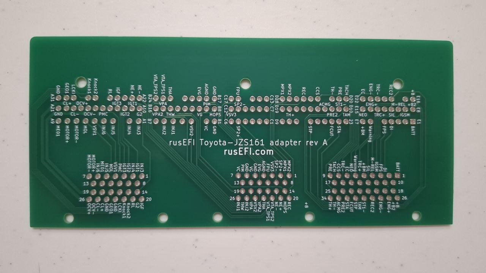

## VAG

### VAG 121 — Bosch ME7

The VAG 121 Superseal adapter connects the 121-terminal vehicle harness (TE 1241434-1) to 60-pin and 26-pin Superseal connectors (1A–34A, 1B–26B and 1C–26C). It retains the Hellen121VAG connector circuits and adds 20 further signals; the remaining 23 vehicle terminals have individual solder access pads.

- **Reference applications:** Audi A4 1.8T (2001) and Audi A6 2.7T, 3.0 and 4.2 (2003), with the Bosch ME7 121-terminal connector. Check the exact engine and model-year wiring against the pinouts. Injector and ignition numbers follow Hellen channel assignments, which can differ from cylinder numbers.
- **Connections:** Passive adapter; GND, GNDA and +5 V groups follow Hellen121VAG. Vehicle-specific signal and power assignments are noted in the pinouts.

[📄 Adapter schematics (PDF)](https://github.com/rusefi/rusefi_documentation/blob/master/Hardware-files/adapters/VAG-121-adapter/VAG-121-superseal-adapter.pdf)

[🚗 Vehicle pinout 🚗](https://rusefi.com/docs/pinouts/VAG-121/) | [🔌 Adapter board pinout 🔌](https://rusefi.com/docs/pinouts/VAG-121-adapter/)

[Reference wiring — Audi A4 1.8T (2001), sheet 1](OEM-Docs/VAG/2001_a4_1.8t_1.png) · [sheet 2](OEM-Docs/VAG/2001_a4_1.8t_2.png) · [sheet 3](OEM-Docs/VAG/2001_a4_1.8t_3.png) | [Audi A6 2.7T (2003), sheet 1](OEM-Docs/VAG/2003_a6_2.7t_1.png) · [sheet 2](OEM-Docs/VAG/2003_a6_2.7t_2.png) · [sheet 3](OEM-Docs/VAG/2003_a6_2.7t_3.png)

[Reference wiring — Audi A6 3.0 (2003)](VAG-C5.md#2003-a6-30) | [Audi A6 4.2 (2003)](VAG-C5.md#2003-a6-42)

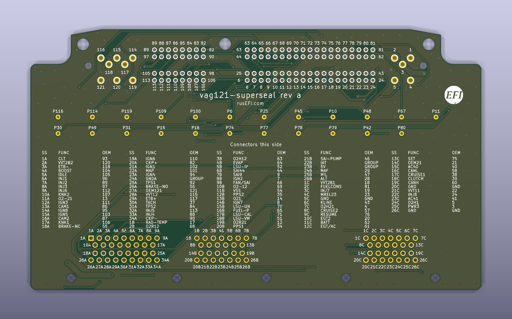

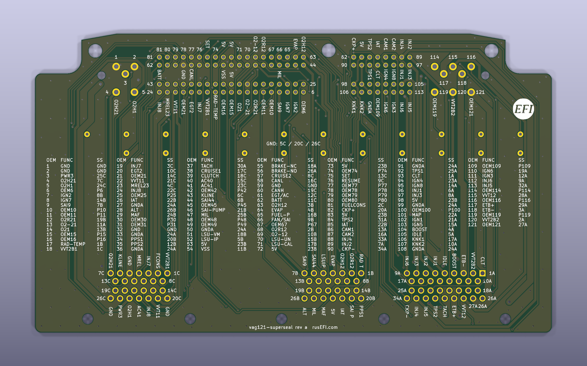
