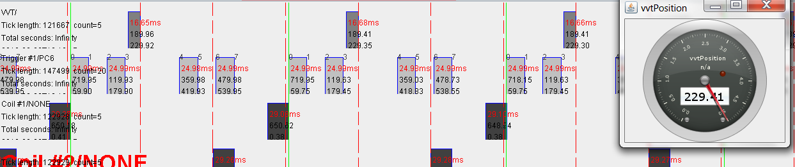
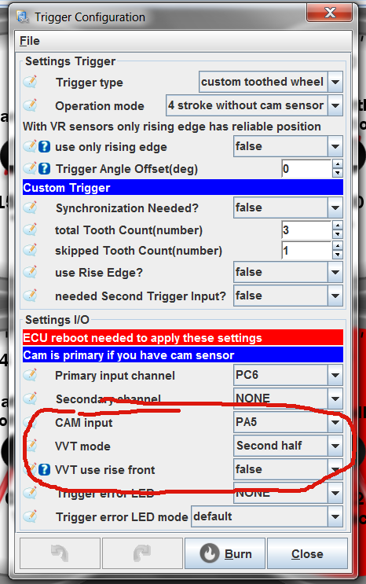

# VVT: Variable Valve Timing

rusEFI has proper closed-loop VVT control, supporting multiple trigger options including:

- "one-tooth"
- Mazda Miata NB (2nd generation)
- Mazda Skyactive
- Toyota 2JZ family
- Bosch Quick Start
- Ford Focus ST 170
- Ford Barra: 3+1
- Nissan VQ family
- Nissan MR18
- Honda K family
- Mitsubishi 3A92
- Mitsubishi 4G92/93/94
- Mitsubishi 4G63
- Mitsubishi 6G75

rusEFI supports up to quad VVT input/output.

rusEFI trigger configuration is the most confusing part of rusEFI configuration, unfortunately.

If rusEFI does not know your exact overall trigger shape and you use a composite setup with a crank sensor driving RPM and a single-tooth cam sensor providing phase information, that's considered "4 stroke without cam with VVT", even if you do not have VVT. :(

## VVT mode 'first half'

This mode could be used for skipped-tooth wheels with single tooth cam sensors in order to support individual injection and coil-on-plug setups.

For example, 3/1 skipped wheel with cam sensor in the first half of the 720 cycle:

Full list see [All Supported Triggers](All-Supported-Triggers)

## VVT control

Beyond decoding cam position, rusEFI can actively **control** variable cam timing in closed loop: it compares the measured cam angle against a target and drives the cam phaser to reach it.

- **Feedback:** the camshaft sensor (`camInputs`) provides the actual cam position. `vvtOffsets` sets the "Angle between cam sensor and VVT zero position", which calibrates the measured cam angle so that the target is meaningful.
- **Target:** separate **VVT intake target** and **VVT exhaust target** tables set the desired cam angle across the operating range.
- **Actuation:** a PID controller drives a PWM output to the cam (oil) control solenoid to move the cam toward the target.
- **Enable conditions:** VVT control requires RPM above `vvtControlMinRpm`, coolant above `vvtControlMinClt`, the configured activation delay after engine start, and usable cam-position feedback. The minimum VVT RPM is independent of the cranking RPM setting.

> ⚠️ **Set VVT limits conservatively.** On interference engines, commanding the cam too far can cause valve-to-piston contact and serious engine damage. Confirm the achievable cam range carefully and verify behaviour on a [log](Logging-Guide) before relying on VVT control.

Configure the VVT targets, PID gains, control pins, and limits in TunerStudio; no values are prescribed here.

## Advanced mode

**VVT Configuration & PID -> Advanced Mode** enables separate intake and
exhaust curves, shared across both banks. It is disabled by default.

- **Base duty vs. oil pressure** replaces the fixed **Hold Duty** offset.
  Missing or invalid oil pressure evaluates the curve at 0 kPa.
- **P factor vs. distance from target** replaces the fixed P gain. Distance is
  target minus measured angle, with its sign reversed for a retarding solenoid.
  The curve displays P multiplied by 100: an entry of 100 means a gain of 1.
- The existing I and D gains continue to supply trim on every update. The
  controller adds that trim to base duty and clamps the result to the PID
  **Min** and **Max** output limits.

Advanced mode controls near-zero targets without the basic mode's rest-position
hysteresis. The RPM, coolant, startup-delay and cam-feedback requirements still
apply. Default curve axes span -40 to +40 degrees and 0 to 1000 kPa; duty and
P-gain values start at zero and need calibration before enabling the feature.

**iTerm Min** and **iTerm Max** bound accumulated integral trim separately for
intake and exhaust, in either mode. Defaults are -1000 and +1000; setting both
to zero restores those defaults on a settings burn. A single zero bound is
allowed. Set **I factor** to zero if integral trim is not wanted. Burning an
advanced-mode calibration resets the accumulated trim.

VVT PID telemetry reports the scheduled P contribution and the final bounded
command during control. The per-cam distance channel reports signed error in
advanced mode; it is zero in basic mode.

## Technical sources

- Configuration field definitions: `firmware/integration/rusefi_config.txt` — `vvtControlMinRpm`, `camInputs`, `vvtOffsets`, the VVT intake/exhaust target tables, and the VVT PID.
